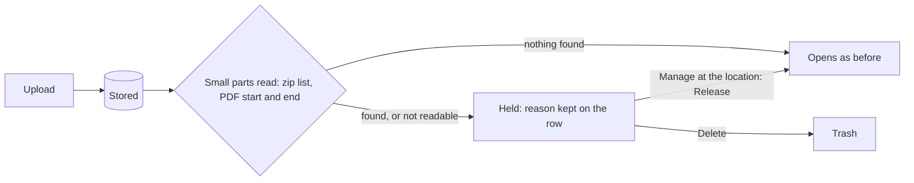

# Files: Held for review and Shared links, batch 4

> **In plain words.** The owner asked for scanning and better management of files (23 November).
> A file that can run something when opened (a program, a zip with a program, macros or a password
> inside, a PDF with JavaScript or a launch action) is now kept but held: nobody opens, downloads,
> copies or shares it until someone who manages its location releases it or deletes it. Names
> that hide their real ending are refused. A new page, **Files, Shared links**, lists every open
> link in one place, with an End it button.

## What changed

| Part | Before | Now |
|---|---|---|
| Programs | a program dressed as another file refused; under its own name kept and openable | also held for review |
| Zips, Office files | kept and openable | held when a program, macros or a password is inside |
| PDFs | kept and openable | held when they name JavaScript, a launch action, an embedded file or rich media |
| Names | no slashes or control characters | also no direction marks, no dot at the end |
| Links | on each file's page | also all on Files, Shared links |
| Data | | migration `0081`: `files_items.held`, the reason in words |
| Errors | | `KIT-E-2412` the file is held for review |

Before, a stored file opened for anyone who could see it. Now an upload's stored bytes are
checked in small parts, and a held file is refused at the one place every download, preview,
copy and link passes through.

## Not a virus scan

A program inside a zip inside a zip, macros in an old `.doc`, or JavaScript inside a PDF's
compressed parts pass unseen; the page tells people to release only what they know. A real
antivirus engine does not fit the free plan's 10 ms of CPU and was left out.

## How it was checked

Zips, PDFs and names read on their own (`test/safety.test.ts`); the module through the pipeline
beside IAM on real D1 (a zip with a program held, refused to download, link and copy, released only
by someone with Manage and opened after, a plain zip not held, a name with a direction mark refused,
Shared links for whoever may share and a link gone once ended); the pages (the held notice, Release
only for a manager, Shared links and End it); then `pnpm verify` (its summary in the commit). Not
run with real files from the wild, a deployed portal or a phone: P484-P487 in
[their own list](../../docs/phone-tests-files.md).
