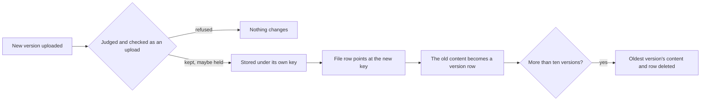

# Files: Versions, Starred and Recent, batch 5

> **In plain words.** The owner asked for a file manager as good as the modern ones (23 November).
> A file can now get a new version without losing its name, location or links, and the last ten
> earlier versions can be brought back with one press. Each person can star files and folders to
> find them under **Files, Starred**, and **Files, Recent** shows what changed most lately.

## What changed

| Part | Before | Now |
|---|---|---|
| Replacing a file | upload again: a second file, numbered | Upload a new version: same file, the one before kept |
| Earlier content | gone | the newest ten earlier versions, each with Restore |
| Finding files | by folder or search | also Starred (per person) and Recent (newest at the person's locations) |
| Data | | migration `0082`: `files_items.content_key`, `files_versions`, `files_stars` |

Before, a file's content always sat at `files/<id>`, so a new upload had to be a new file. Now
each file row says which key holds its current content, so a new version is a new key and the old
key is kept as a version until ten newer ones push it out.

## Left for later

- Downloading an earlier version without restoring it (Restore can be undone by restoring again).
- Counting earlier versions in the rooms and the storage check.
- File requests (people outside the portal uploading into a folder by link): the next batch.

## How it was checked

The module through the pipeline beside IAM on real D1 and the test bucket (a new version under the
same name, refused without Change and as a disguised program, restored with the one it replaced
kept, ten kept with the older content gone from the bucket, every version's content gone with the
file, a held version and the clean one restored, a star for the person alone, Starred, Recent
leaving out another location's files); the pages (Star, Versions with Restore and the upload, the
two lists); then `pnpm verify` (its summary in the commit). Not run on a deployed portal, against
an outside S3 bucket or on a phone: P488-P491 in [their own list](../../docs/phone-tests-files.md).
