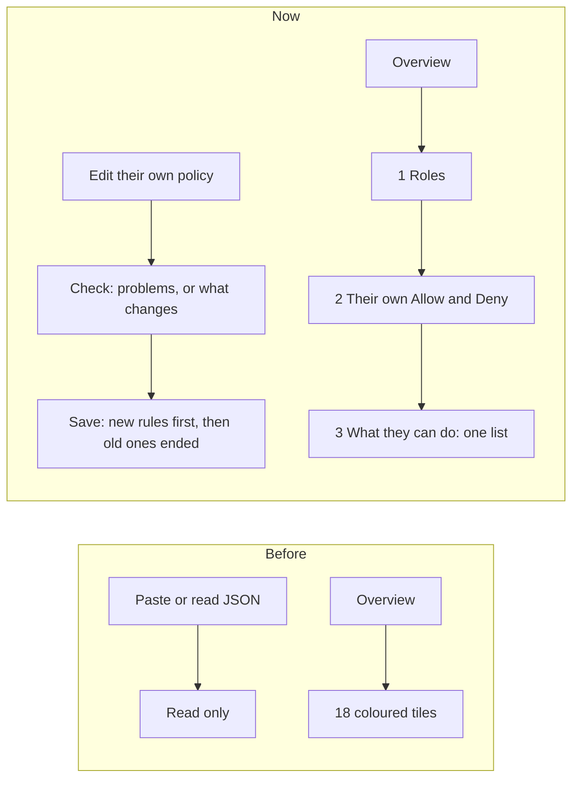

# A locked page layout, the user page remade, Policy JSON you can edit, and the line under the portal's name

> **In plain words.** On 23 November the owner said a user's page was "terrible and un-usable",
> that pages had no fixed places for buttons and features, that a user's Policy JSON could only be
> read, and that "Admin portal" under the portal's name could not be changed. The layout every page
> follows is now written down as fixed rules: where the title, the record's own pages, the view
> switch, each card's tools and the colours go. A user's overview reads in the order their access
> is made, as numbered cards: 1 their roles, 2 their own Allow and Deny, 3 what that adds up to, as
> one plain list instead of eighteen coloured tiles, with their account beside it. Their Policy
> JSON can be edited like AWS's inline policy: Format, Copy and Download, a line that says at once
> whether the JSON is valid and where not, Check to see what Save would change, then Save. Settings,
> Name and icon gains the line under the name and a preview of the sidebar, the phone bar and the
> browser tab that changes as you type.

## What changed

| Before | Now |
|---|---|
| No written rule for where a page's parts go; each page placed its buttons its own way | "Page anatomy (locked)" in the design skill: head, section tabs, title row, a record's pages with the view switch at the right of the same row, cards with their tools at the top right, two columns for a record from 1024 px, one meaning per colour, code in `.ui-code` |
| A user's page showed the chips of the pages under Users (Signed in today, Access requests) | Those chips show only on the Users list and on those pages |
| Permissions and Policy JSON switched on a row of their own | The switch sits at the right end of the row of the user's pages |
| Overview: Roles, then "Access by module" as a grid of tiles tinted by level with a legend, then overrides, then Account at the foot | Numbered cards 1 Roles (Add role at the top right, a dialog), 2 Their own Allow and Deny (Change), 3 What they can do (one list, most first, the areas with nothing as one line); Account in a rail beside them |
| "Custom" for a module that matches no ready-made level | "Limited", the word AWS uses for some of an area |
| Policy JSON of a user: read only, with Copy | Their own Allow and Deny as an editable policy beside their roles (read only, each linking to its own Policy JSON); Format, Copy, Download, live JSON check, How to write a rule, Check and Save |
| "Admin portal" fixed under the portal's name | `settings.portal_tagline`, set on Name and icon, empty for "Admin portal"; a three-place live preview |

**How Save stays safe.** The text is read against the permissions and locations the portal has; a
wildcard never takes the Owner's or the Vendor's own permissions; one permission allowed and denied
at the same place is refused; a new Deny waits for its box, as on the Permissions view. Save makes
the new rules first and ends the old ones after, so a refusal never leaves a Deny already gone, and
the portal's API checks each change as if made by hand. One save takes at most 12 changes: each is
about three database queries and a request on the free plan has 50 (a save of two measured 13).

**Impact on each part.** Screens: the person pages, the policy editor and its route, the Settings
card, the chips under a tab, the `Card` primitive. Core UI: the panel, code and step classes (the
stylesheet's cap rises from 172 to 176 KiB, with the reason in its test). Core config: one setting.
The template: reads the new setting with the others. No table, permission or migration changed.

**How it was checked.** The screens and core UI tests (the policy parser, the changes it works out,
the editor's markup, the one list), the client template's screens test (Check, a broken JSON, a
refused Deny, a Save and its query count, the overview's order, the line under the name), each page
looked at on this computer at 390 and 1440 pixels, then the full `pnpm verify`. Not checked: a phone,
the live portal.
