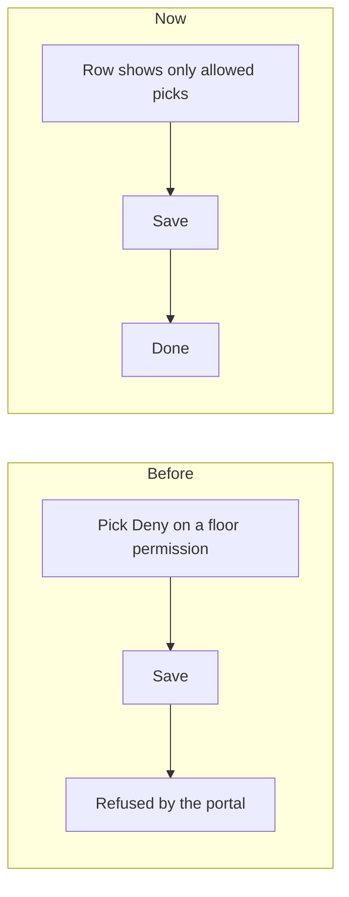

# The access pages checked against the locked layout

> **In plain words.** On 24 November the owner asked for the next phase: more robustness, security
> and permission management, and the gaps worth closing. Every Users and access page was looked at
> against the page layout fixed the day before. Four things did not follow it and are fixed: a
> role's Assigned to tab was titled "Role" and was one long column; Groups with no groups showed a
> bare sentence; a user's Permissions on a phone pushed the modules far down under a blue box; and
> a permission's row offered picks the portal would refuse on Save. The gaps found and what to build
> next are at the end.

## What changed

| Before | Now |
|---|---|
| A role's Assigned to tab titled "Role", holders, rank and Remove one under another | Titled with the role's name; a card Assigned to (Pick a user when no one holds it) and, beside it, Rank (Move up, Move down at the card's top right) and Remove |
| Groups with none: one plain sentence | The empty state, No groups yet, saying what a group is for |
| A user's Permissions: a count, a blue Owner box, the search beside Access ends | One line, "N of M permissions at the location and inside it", with what an Owner has and who can deny one; the search alone above the list; Access ends under it |
| Each row offered Inherit, Allow and Deny, or none at all | Only the picks the portal saves: the Vendor's own Inherit or Allow (the Vendor alone), the Owner's own Inherit or Deny (on an Owner), an Owner's Users and access permissions Inherit or Allow unless the Vendor changes them; a saved pick always stays on show |

**Impact on each part.** Screens only: the role page, the Groups list, a user's Permissions and the
permission rows. No route, table, permission or migration changed; the portal still checks every
change, so the page offering fewer picks is a help, not the guard.

**How it was checked.** The screens tests (a row offers only what the portal saves, a saved pick
stays on show), the client template's screens test (the role page's heading and Rank card, No groups
yet, the line on Permissions for an Owner and for the Vendor), the pages looked at on this computer
at 390 and 1440 pixels, then the full `pnpm verify`. Not checked: a phone, the live portal. Also
swept: the stylesheet for classes no page uses (none found, so nothing to cut there).

## Gaps found, and what to build next

| Gap | Why it matters | Next step |
|---|---|---|
| The role, group and holder lists read at most 200 rows, with no next page | A large client would see a list cut short with no sign of it | Paging, or "Showing the first 200" with a search |
| A new Deny is confirmed by a box beside Save | The design rule puts a step that takes access away in a dialog | Move it into a dialog (`ConfirmDialog`) |
| On a phone, Users' Invite sits on a row of its own | Room above the list | Put it on the title row, as the layout says |
| The other sections (Settings, Home, Email, Files, Data) were not yet checked against the layout | The owner's "locked places" apply everywhere | One section per batch, the same way as this one |
| The portal's API is reached only by a signed-in person | A client wanting another system to call it needs keys with their own permissions | Build when a client asks: keys held by name, each with a role and an end date |
