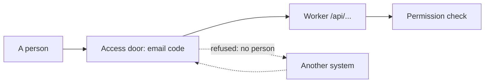
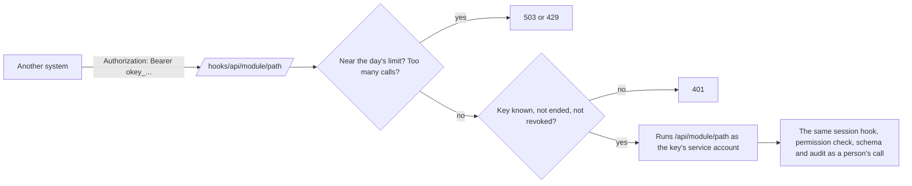

# API keys: another system calls the portal

> **In plain words.** Until now only people could use the portal: the door asks for a code sent
> to an email address, so an accounting tool or a script had no way in. Now an Owner can make an
> API key under Users and access, Settings, API keys. The key belongs to a service account that
> holds one role at one location, so it can do exactly what that role allows and nothing more,
> and it can never hold the Owner role. The key is shown once, only a fingerprint of it is kept,
> and Revoke stops it at once. The owner picked this on 2026-11-24, with fresh sign-in left off
> for keys.

## What changed

Before: every call needed a person signed in through Cloudflare Access.

Now: a key's call goes to `/hooks/api/...`, a path the door already leaves open, and the Worker
reads the key itself.

- **Made through the grant rules.** Making a key makes a service account and gives it the role at
  the location like any grant, so a key never gets more than its maker may give. The Owner role
  is refused outright: a lost key must not be able to hand the company over.
- **Kept as a hash.** The key is `okey_` and 64 hex characters, shown once on the answer to Make
  (no redirect, so it is in no address or browser history). Only the SHA-256 of its secret is
  stored, compared in constant time.
- **Stopped at once.** Revoke switches the account off and ends its session; a key with an end
  stops at that time. Its last use is written at most once an hour, to keep D1 writes small.
- **Held to an Owner.** Making and revoking need the new permission `iam.keys.manage`, held to
  the Owner role. Both are in the audit log (`iam.key-made`, `iam.key-revoked`).
- **Rests like every public address.** The busy answer near the day's D1 limit and the rate
  limiter (per key) apply, as for hooks.

## Impact

| Part | Change |
|---|---|
| `@oltrem/iam` | `iam.keys` (make, list, revoke, verify), three routes, `may.keys`, the capability, migration `0089_iam_api_keys.sql` |
| `@oltrem/core-http` | `keys` option and `/hooks/api/` (`KEY_PATH`); the module id `api` is kept |
| `@oltrem/core-module` | an identity's `door` may be `key` |
| `@oltrem/screens` | the API keys page under the Users and access Settings tab |
| Client template | passes `iam.keys.verify`; the migration copied |

Nothing new on Cloudflare: no binding, variable or Access change.

## How it was checked

- `modules/iam/test/keys.test.ts`: a key made with a role the maker may give, kept as a hash,
  calling as its account with no sign-in row, refused what its role lacks, last use written
  hourly, a wrong key refused, revoked at once; the Owner role refused with nothing left
  behind; an ended key stops.
- `packages/core-http/test/app.test.ts`: a key's call runs the route; refusals, the busy answer,
  the limiter and a switched-off module; the id `api` refused.
- `packages/screens/test/api-keys.test.ts`: the list without the key, no Owner role offered, the
  key shown once, revoke.
- The full verify chain (summary in the commit). Not checked: a live portal.
