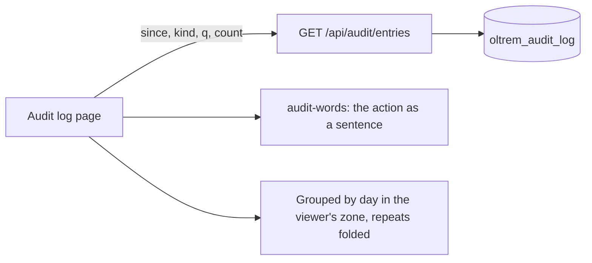

# The Audit log remade, and every page full width

> **In plain words.** The owner asked (24 November) for a top-to-bottom remake of the Audit log
> ("difficult to read and not well made"), and for every page whose options used only half the
> screen to be fixed. The Audit log now reads like GitHub's and Google Workspace's: one sentence a
> row, under its day, in your own clock, with a search and quick filters, and a row that opens to
> what changed. The half-width pages had one cause, fixed once for all of them.

## What changed

| Part | Before | Now |
|---|---|---|
| A row | a table: the action's code, a shortened id, an address, a country | one sentence: "Ana changed the role **Front desk**", the section, browser and country under it, a refusal's reason in red |
| Time | UTC, one long list | grouped by day (Today, Yesterday, Saturday, 21 Nov) in the viewer's time zone, kept by the frame script in a cookie |
| Finding | two filter rows and tapping an address | a search over people, records, addresses and actions; When (24 hours to 90 days), Everyone, People or Automatic, result, section; counts of entries and refusals |
| Repeats | every sign-in its own row | the same thing done again right after is one row, "3 times" |
| Opening a row | every fact as from → to | What changed as Field, Before, After; why it was refused; where from; how (request, answer, time taken); the entry; links to everything that person did and everything done to that record |
| The API | outcome, module, person, record, action | also `since`, `kind` (people or automatic), `q` (words, `%` and `_` literal) and `count=1` (rows of each result across pages) |
| Half-width pages | a lone card in a two-column set sat in the left half; form pages capped at 64rem; Options a short row | a lone card fills the row (`:only-child`); form pages run the full width with their steps side by side (`.ui-duo`, Email services' setup); a tab's Options are one full-width card, each switch with its words; the empty save bar no longer leaves a strip |

Nothing new is stored and no setting was added; the search reads the rows of the chosen range
only, newest first, 50 a page. The Audit log makes one more database read (the counts by result,
5 in all), and the stylesheet's cap rises from 176 to 180 KiB (about 178 KiB with the other
threads' pages of the same day).

## How it was checked

The audit package on real D1 (search in any field and case, literal `%` and `_`, people or
automatic, counts across pages), the page's tests (every phrase, days and zones, folding, a row
and what it opens to, the addresses of filters, setting keys as words), the stylesheet's tests
(no form width cap, the lone-card rule, the new classes), the Options card's render, and
screenshots of the local portal at 390, 1440 and 1840 px with sample rows. Then `pnpm verify`
(its summary in the commit). Not run on a deployed portal or a phone: P540-P546 in
[their own list](../../docs/phone-tests-system.md).

## Left for later

Sign-in rows that kept no browser, names on audited reads of connected data, and quieter rows
for automated visits to public links are written at the source, a later batch.
