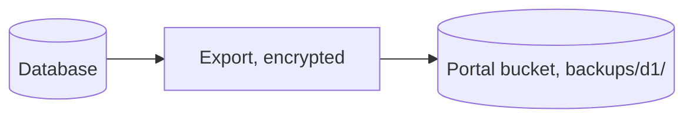
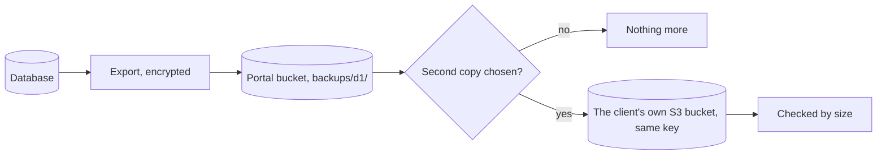

# A second backup copy outside Cloudflare

> **In plain words.** Every backup copy was kept in the client's own Cloudflare account. If that
> account were lost, the copies would go with it. Now an Owner can pick a bucket of their own at
> another storage service (Amazon S3, Backblaze B2, Wasabi and the others Files can join) on the
> Backups page, and each database copy is kept there too, still encrypted. It is off until a
> client picks one, as the owner chose on 2026-11-24.

## What changed

Before: one copy, in the portal's bucket.

Now: the same encrypted copy is also kept in the chosen storage connection.

- **Off by default.** The setting `backup.outside_store` is empty on a new portal, and the run
  adds no step while it is.
- **Still encrypted.** The second copy is the same bytes as the first. The storage service never
  sees the data, and only the Vendor's private key opens it.
- **Never fails the backup.** The first copy is stored and checked before the second is made.
  If the second fails, the run stays good, says so in what its check found, and the error opens
  an alert.
- **Uses Files' storage connections.** No new key, binding or service: the bucket is joined once
  under Files, Storage, with its key sealed as before.

## Impact

| Part | Change |
|---|---|
| `@oltrem/backup` | `outside` option, the `copy outside` step, the setting, `outside` on the status route |
| `@oltrem/screens` | Backups page: "A second copy outside Cloudflare", for an Owner |
| Client template | opens the chosen connection through the providers registry and Files' S3 store |

## How it was checked

- `modules/backup/test/backup.test.ts`: none chosen, no step and nothing opened; chosen, the
  same encrypted bytes kept and checked; refused, the run stays good, says so and reports it.
- `packages/screens/test/backups.test.ts`: the pane only where it can be set, the way to Storage
  with none joined, the choice saved or cleared.
- The full verify chain (summary in the commit). Not checked: a real S3 bucket.
