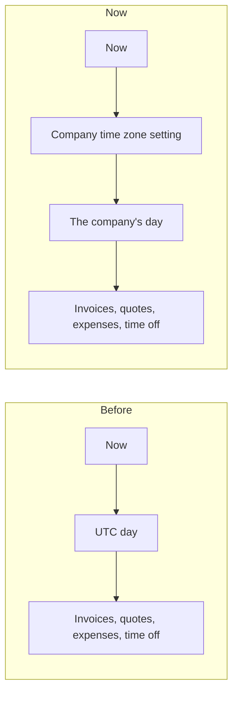

# Which day today is follows the company time zone

> **In plain words.** Invoices, quotes, expenses and time off worked out which day it is from
> UTC. For a company in Mexico City, UTC's day changes at 6 in the evening. From then on that
> evening, a due date of today was refused as already past, and a reminder could call an
> invoice overdue on the day it was due. For a company ahead of UTC, the morning's expenses were
> refused as spent in the future. Now all four read the day from the company's own clock, the
> same setting bookings, the time clock and send later already used. Its title changes from
> "Time zone for bookings" to "Company time zone", and its key stays the same, so nothing saved
> changes.

## What changed

| Where | Today was | Now |
|---|---|---|
| Invoices | the UTC day: due date checks, overdue, the money owed, reminders | the company's day (`timeZone` option, from `bookings.time_zone`) |
| Quotes | the UTC day: valid until, expired, the answer's day | the company's day |
| Expenses | the UTC day: "spent today or before" | the company's day |
| Time off | the UTC day: upcoming, withdraw | the company's day |
| Settings | "Time zone for bookings" | "Company time zone", same key |

Each store takes an optional `timeZone`, and UTC is the default when it is left out, so a module
used without the template behaves as before. Analytics still groups its events by the UTC day,
because its module does not read settings. That is noted here and not changed.

## How it was verified

- Invoices and expenses each gained a test that picks a zone whose day differs from UTC's at the
  test's moment (a day behind early in the UTC day, a day ahead later on), then shows the same
  date taken on the company's clock and refused on UTC's, or the other way round. Without the
  change both give the same answer. Quotes 19 and time off 14 tests pass unchanged. Full verify in
  the commit.
- Not done: a live portal (phone test P529).
