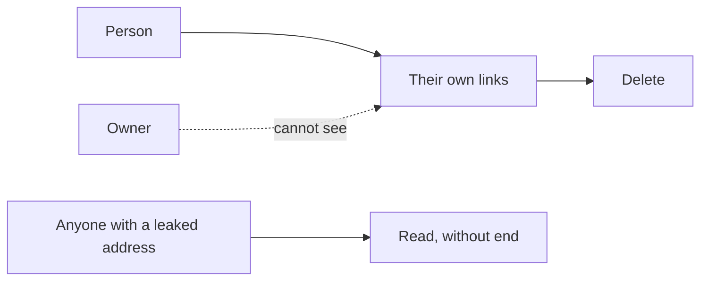
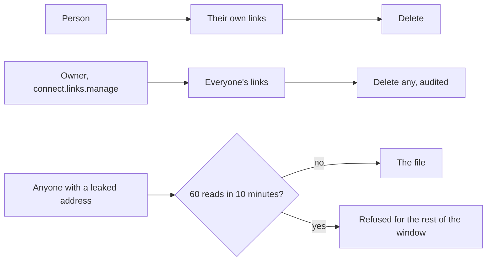

# Everyone's links, and a link read too often

> **In plain words.** The owner asked every thread for the next phases: more security, better
> permission management, robustness and smaller code (24 November). On the Apps page the gap was
> the calendar and spreadsheet links people make: only their maker could see or delete them, and
> a leaked address could be read without end. Now an Owner (anyone given the new permission "See
> and delete everyone's calendar and spreadsheet links") has a page listing every link in the
> company, whose it is and when an app last read it, and deletes any one in two taps. A link read
> far more often than any app needs is refused for ten minutes.

## What changed

| Part | Before | Now |
|---|---|---|
| Who sees a link | its maker only | its maker, and whoever holds `connect.links.manage` (admin, at the company) |
| Ending someone's link | only by signing the person out, which ends them all | Delete on `/connect/links`, one link, audited as `connect.end` with whose it was |
| A leaked link | read as often as anyone liked | 60 reads in ten minutes in one isolate, then `KIT-E-0429` until the window passes, before the database is asked |
| Code | the link's logo and name written twice on the page | one `LinkLogo` and one `linkName`, used by Connected and the new page |

No table, migration, setting or variable. `/connect` keeps its 10 queries: the permission is read
from the capability index the page already loads.

## Impact on each part

- **connect:** the capability, two routes, the page, the read limit, `Mine.manage`.
- **Everything else:** nothing.

## How it worked before

## How it works now

## How it was verified

- `modules/connect/test/connect.test.ts`: without the permission the list and Delete are refused
  and `manage` is false; with it, the list names the person and never the secret, Delete ends the
  link (its address answers 404) and the audit row names who deleted it and whose it was; the
  61st read in a window answers 429.
- `pnpm verify`, quoted in the commit.
- Not checked: the live portal; phone tests P512 to P514 are owed.
