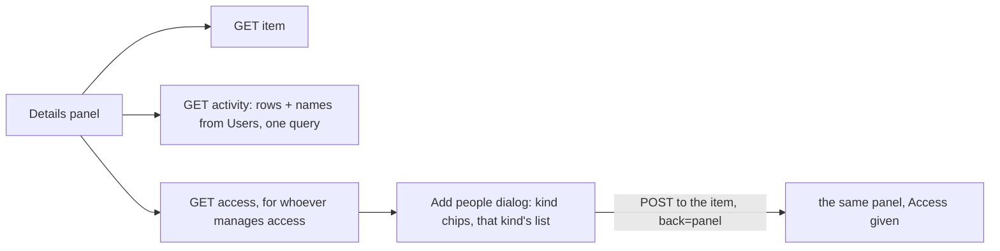

# Files: the details panel made clear

> **In plain words.** The owner opened a file's details on his phone and found it confusing:
> the type was a technical name ("application/x-msdownload"), times were in UTC, people were
> email addresses, access sat behind a button on another page, and the activity read
> "files.access-grant". Now the panel says what the file is in words, shows times in the
> viewer's own time zone and names where people gave one, holds Who has access itself, and
> lists the activity with a coloured icon and plain words for each action.

## What changed

| Part | Before | Now |
| --- | --- | --- |
| Type | the stored type, "application/x-msdownload" | "Program (EXE)", "PDF document", "Picture (PNG)", with the size; the stored type on hover |
| Changed, By | "2026-11-24 17:36 UTC", then the address | "24 Nov, 12:36 by Ann Lee" in the viewer's zone (the time zone their browser keeps in the `oltrem_tz` cookie, UTC said until then); the name given under Users, else the address |
| Access | a Manage access button to the item's page | **Who has access** in the panel for whoever manages access there: the folder's general access with Restrict, each person, group or role with its level on a badge of its colour, the open links on a row; a change posts to the item and comes back to the panel |
| Add people | one list mixing people, groups and roles | first A person, A group or A role in a sideways row, then only that list; under the levels, what each lets them do |
| Activity | address, raw action key for some, UTC | an icon of each action's colour (uploads blue, links violet, access teal, trash rose, restores green), the name, the action in words ("gave Edit access", "uploaded"), the item's name only when it is another item, the viewer's time |
| A folder's panel | a Download button | none (a folder does not download) |

## How it works now

The activity reads the names in one query over the actors it found (`iam_principals` joined to
`users_profiles`, the company's own and the Vendor's), so the panel stays inside its query
budget. Nothing new is stored.

## Verified

- The files module tests on real D1, now with the Users tables: the activity carries the name a
  person gave and an empty name for one who gave none.
- The pages tests: "Program (EXE)" and not the stored type; 17:30 UTC shown as 12:30 for a
  viewer in Toronto; Who has access in the panel posting to the item with the panel as `back`;
  a group picked in the chips posts as that group and returns to the panel; the person, group
  and role chips and the levels' words on the item's page.
- A headless phone screenshot of the panel, dark. The full verify chain (summary in the commit).
- Not checked: a real phone (P556 to P558).
