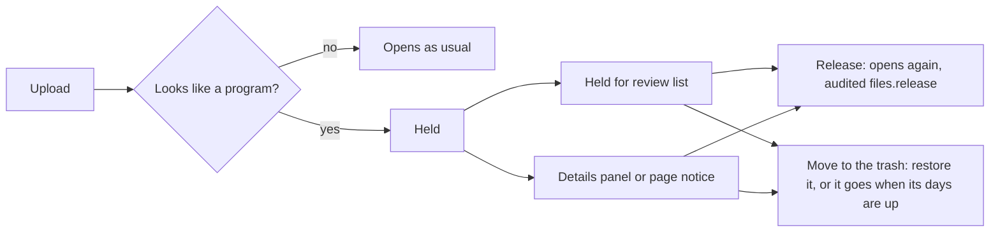

# Files: reviewing a held file

> **In plain words.** A file that looks like a program is held: nobody opens it until someone
> who manages its location releases it. The owner uploaded one and saw the notice in the details
> panel with no button: Release sat only beside the title of the file's own page, and nothing
> listed the held files. Now the notice itself carries Release and Move to the trash, the row's
> menu has Release, and Files, More, Held for review lists every held file to act on.

## What changed

| Where | Before | Now |
| --- | --- | --- |
| The held notice (the file's page and its details panel) | why it is held, and "release it or delete it" in words only | the same words, then **Release** (for whoever manages access at the location) and **Move to the trash** (for whoever may change it); none in the trash |
| The file's page, beside the title | a filled Release button | no filled button for a held file: the notice holds both |
| A row's menu | Download hidden, nothing to release | **Release** for a held file, for a manager |
| Files, More (a chip on a phone) | no way to find held files but folder by folder | **Held for review** (`/files?show=held`), for whoever manages a location: each held file there, newest first, with its place, its reason and both buttons, which lead back to the list with a notice |
| The API | none | `GET /held` (`files.access`): the held files at the places the person manages, one query, at most the listed limit |

## How it works now

Release still goes through `POST /items/:id/release`, which refuses anyone without Manage access
at the location (403), so the buttons only save looking for the action; they grant nothing.

## Verified

- The files module tests on real D1: a clerk's held upload is listed by `GET /held` for the
  manager, refused to the clerk (403), and gone from the list once released; the manifest has 40
  routes.
- The pages tests: the notice's Release and Move to the trash forms, none in the trash; the Held
  for review list with the reason and both buttons, its notice, and each leading back to the
  list; the menu's new More row.
- The full verify chain (summary in the commit). Not checked: a real phone (P553, P554).
