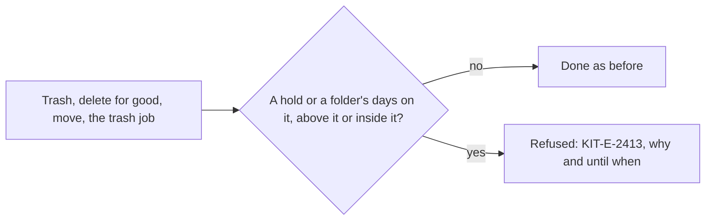

# Files: keep for and legal hold, phase 9a

> **In plain words.** The owner asked (24 November) for more robustness and permission
> management for the long term. A folder can now keep its files for a set time (for example 7
> years for invoices), and a folder or file can be put on legal hold. While kept, nothing it covers
> can be thrown away, deleted or moved, by a person or by the trash's daily clean-up.

## What changed

| Part | Before | Now |
|---|---|---|
| Keeping files | anyone with Change could trash them; the trash emptied after its days | a folder's **Keep each file for** (30 days to 7 years) refuses the trash, delete and move until each file's day |
| Legal hold | | a reason on a folder or file: nothing inside goes, every earlier version stays, until lifted |
| Who sets it | | whoever manages access at the location, audited as `files.keep` |
| The trash's job | deleted everything past its days | skips what a rule or hold keeps |
| Errors | | `KIT-E-2413` (409) says why and until when |
| Data | | migration `0084`: `files_items.keep_days`, `files_items.hold` and an index |

The check is one statement that walks up from each item to the folders above it and down to what
is inside it; a company with no rule pays one small indexed read instead.

## How it was checked

The module through the pipeline on real D1 (a folder's days refusing the trash, a move and bulk
trash while a rename works, set only on a folder and by whoever manages access; a legal hold
refusing delete for good and the trash's job, holding its folder through what is inside and keeping
all twelve versions; both lifted and the item going again), the pages against answers of the API
(the notice, the form for a manager only, the values sent), migration 0084 applied by the tests'
own runner, then `pnpm verify` (its summary in the commit). Not run on a deployed portal or a
phone: P502-P504 in [their own list](../../docs/phone-tests-files.md).
