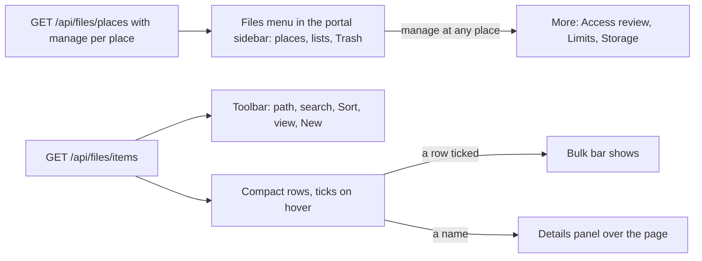

# Files: the page made over, and its Settings tab

> **In plain words.** The owner asked (24 November) for a complete makeover of the Files page, and
> then for its access pages to keep one solid bar on the side instead of a bar of chips across the
> top, and for Files › Settings to lose its wasted room. On seeing a second sidebar he asked for
> the portal's own sidebar only. The Files menu now sits in the portal's sidebar under Files, the
> folder is one clear panel with its tools in its head, the list is compact and coloured by kind,
> and the Settings tab is one plain list with each box only as wide as it needs.

## What changed

| Part | Before | Now |
|---|---|---|
| The left side | a second sidebar beside the portal's, with a tree on the folder pages only; Access review, Limits, Storage and the lists had a row of chips across the top | the Files menu in the portal's one sidebar under Files, as Email's folders: places, Starred, Recent, Shared with me, Shared links, Trash, then under More Access review, Limits, Storage (for whoever manages access somewhere) and the Storage meter; the page keeps its full width |
| Saved views | a "Name these filters / Save view" bar on every Files page | gone: the Files menu already names every list |
| The toolbar | path, search, a List/Grid chip row; Upload, Upload a folder and New folder as three equal buttons below, all on the page's background | the folder is one panel; its head holds the path (earlier folders muted, the current one bold) over the folder's totals, then search, a Sort menu, List and Grid as one switch, and **New** with a menu: the page's one filled button |
| The summary | the whole location's files and bytes, with a drag hint | the folder's own folders, files and size |
| The rows | a table that broke long names letter by letter beside the details; big labelled cards on a phone; one grey icon; a full UTC time; the uploader's email | compact rows: a tile coloured by kind, the name on one line, `24 Nov` (the full time on hover), the size; on a phone size and date under the name |
| Ticks and the bulk bar | a round tick on every row and the bar always shown | a square tick on hover, once one is ticked or always on a touch screen; the bar only while something is ticked |
| Details | a pane that squeezed the list | a panel over the right of the page, the rest dimmed; a press outside closes it |
| Empty folder | a sparkle | an upload icon: drop files here, or press New |
| Files › Settings | a card with a head repeating "Files" and "Settings of a part the page does not name yet", wide boxes, two values shown as raw JSON "changed through the API" | the rows straight under the tab, each box as wide as it needs, shorter descriptions, and "Change it on its own page" for the limits and the storage choice |
| Settings rows everywhere | words in two fifths, the box in three fifths, the key on its own line | the words take the room, the box column is 22rem, the key beside the title |
| Data | | none changed; `GET /places` adds `manage` per place, a setting may name `setOn`, the page that sets it, and a sidebar menu's Compose is optional |

## How it works now

Before, each page of Files drew its own top: the folder pages a tree, the other pages a chip row
of places and lists, and the frame added a Save view bar to all of them. Now one `Shell` hands the
Files menu to the portal's sidebar (the `SideMenu` slot Email uses) and draws the phone's chips,
for every Files page, from the places answer alone: whether to show the
manage pages comes from the `manage` flag the places route now returns, so no page reads more than
before. The bulk bar and the ticks are shown by CSS (`:has(:checked)`), with no script.

The section Settings tab is drawn by the shared settings list in its compact form: with one part
it shows the rows with no card, with several a plain heading per part. A setting whose value has a
page of its own (`setOn`, checked to be a path of the portal) shows a link there instead of its
stored value.

## Verified

The module's pages against answers of the API: the Files menu for the sidebar, the shell on the drive and on Access review, the
folder's own totals, short dates, New and its folder dialog, the Sort menu, the bulk bar only with
rows, the empty folder. The places' `manage` flag on real D1 (the Owner manages every place, a
writer none). The local portal looked at 390 and 1440 px wide in light and dark: Files, a folder,
Grid, Trash, a file's panel, Access review, Files › Settings and Settings. Then `pnpm verify`.

Phone tests: P523-P528 in [the Files list](../../docs/phone-tests-files.md).
