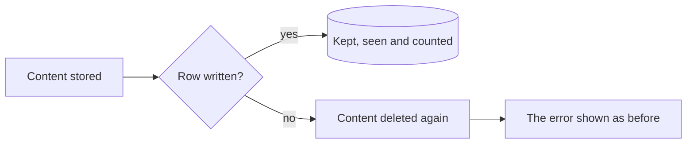

# Files: tidy, safer writes and earlier versions, phase 7

> **In plain words.** The owner asked (24 November) for more robustness and for the code to be
> made smaller where it can. Repeated code in Files was folded into shared helpers, a stored file
> is never left behind without its row, earlier versions now count toward the room a location has,
> and an earlier version can be downloaded on its own.

## What changed

| Part | Before | Now |
|---|---|---|
| Stored content whose row fails to write | left in the bucket, unseen and uncounted | deleted again (upload, copy, new version, file request) |
| Earlier versions | not counted in any room or the storage check | counted in their location's room and the storage check |
| An earlier version | only Restore | Download it on its own (`?version=`), audited; not when held or View only |
| Repeated code | the room sum, the version row, the content update, passcode misses, the visibility loop, the public pages' frame, the tree links, the link rows written out several times | one helper each |
| Data | | no migration |

## How it was checked

The module through the pipeline on real D1 and the test bucket (an earlier version downloaded and
an unknown one not found, a held file's clean version downloaded, a location's room counting
earlier versions, and every earlier Files test unchanged), then `pnpm verify` (its summary in the
commit). Not run on a deployed portal or a phone: P496-P497 in
[their own list](../../docs/phone-tests-files.md).
