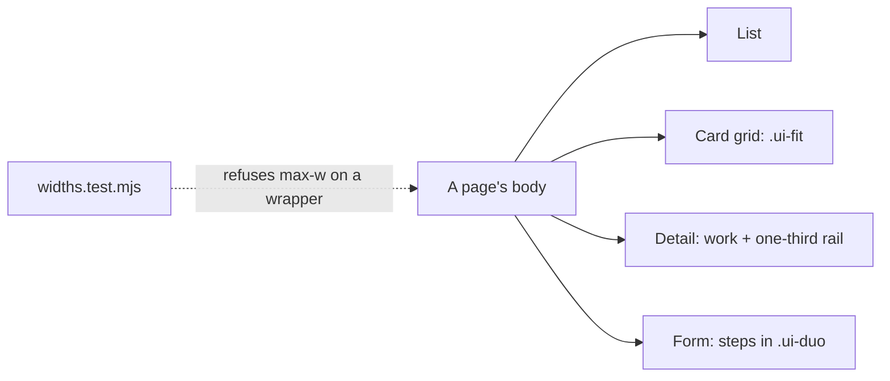

# Layout rules: card grids, no width caps, four page layouts

> **In plain words.** The owner asked (24 November) to rethink how pages are laid out and how
> the libraries are used, because pages kept using half the screen. The design thread agreed to
> four rules, now written into the design skill and checked where a check can hold them: cards in
> a set are a grid that fills the row, no page or card caps its width, every page body is one of
> four layouts, and each library has one job.

## What changed

| Part | Before | Now |
|---|---|---|
| Cards in a set (Settings, special permissions) | CSS columns from a set width: a lone card sat in the left half, uneven cards left holes | one grid, `.ui-fit`: as many columns as fit at the card's least width (28 rem, Settings 36 rem), empty tracks folded so a lone card takes the row, each card its own height |
| Width caps | allowed on forms (`max-w-xl`), a 64 rem form page | refused on any page, card, form, column or grid by `scripts/widths.test.mjs`; prose keeps `max-w-[72ch]`, dialogs, drawers, menus and toasts size themselves |
| Page bodies | built per page | one of four: list, card grid, detail (a one-third rail from 64 rem, replacing the old two-columns rule), form (`.ui-duo` steps) |
| Libraries | daisyUI, kit classes and Tailwind mixed | daisyUI for controls only, kit primitives for layout and surfaces, Tailwind for spacing inside one component; for new and touched code, no mass rewrite |
| The first company form | two fields in a narrow column | side by side on a wide page |

## How it was checked

The width check's own cases (a capped column, grid, card and page refused with their lines;
prose, a drawer, an image and a piece in a row allowed), then the kit's screens, where it found
three capped forms, now fixed; the stylesheet's tests (no CSS columns left, the grid rule, the
wider Settings cards); `pnpm verify` (its summary in the commit). Not run on a phone: P547-P548
in [their own list](../../docs/phone-tests-system.md).

## Left for later

An on-demand screenshot check of every page's width needs Playwright as a new dependency, which
waits for the owner's yes.
