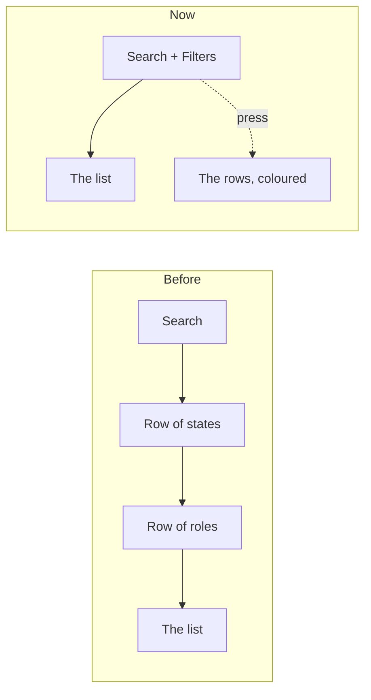

# One toolbar line and coloured chips

> **In plain words.** On 24 November the owner said the filters and search bars took 30% or more
> of the screen and that pages looked bland, with no colour coding. A list's search and its filter
> rows are now one line on every page: the rows that do not fit fold behind a Filters button
> beside the search, which says how many filters are on. On a phone that is every row after the
> search, so a list starts right under it. Chips that name a state now carry its colour, and chips
> that name a thing carry that thing's own colour, as a small dot.

## What changed

| Before | Now |
|---|---|
| Users on a phone: the search, then the states, then the roles, each a row of its own | The search with Filters beside it; the users right under it |
| The Audit log on a phone: the search, Export, When, Who, Result, Section, six rows before the first entry | The search with Filters beside it, then Export; Filters opens the four rows |
| On a computer, filter rows that did not fit started lines of their own | Those rows fold behind Filters; the ones that fit stay on the search's line |
| Every chip the same grey | A state's colour (Active green, Refused amber, Failed or Blocked red, Invited blue, Deactivated grey) or a thing's own (each role, each section), as a dot |

**How it works.** It lives in the shared frame, so every list follows it without a change of its
own: the page script measures which `.ui-filters` rows after a page's search share its line and
folds the rest behind the button; on a phone the stylesheet hides them before the script runs, so
the list never jumps. Without the script every row shows, as before. `ChipRow` gained `tone` and
`hue`; the rule is in the design skill ("One toolbar line").

**Impact on each part.** Core UI: the chip's colour dot and the fold. Screens: the page script,
Users' and the Audit log's chips. No route, table or permission changed.

**How it was checked.** Core UI's chip test, the client template's screens test, Users and the
Audit log looked at on this computer at 390 and 1440 pixels, then the full `pnpm verify`. Not
checked: a phone, every list page one by one.
