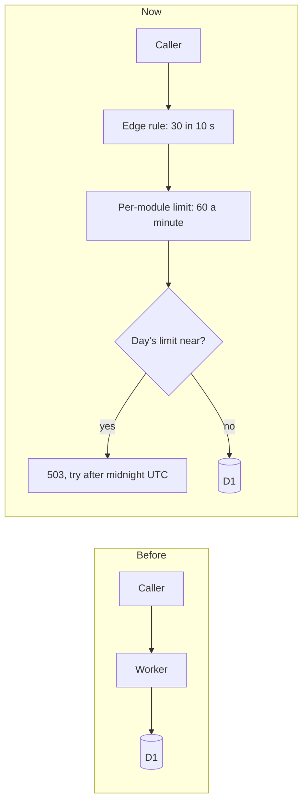

# Public addresses rest before a limit, migration rules checked, a figure per request

> **In plain words.** The owner asked for the gaps in the kit's architecture. The largest one:
> since September 2026 Cloudflare's free plan refuses every database query for the rest of the
> day once the day's rows run out, so anyone who posts to a portal's public addresses (a form, a
> webhook, a shared file's link) fast enough could stop the whole portal until midnight UTC. The
> budgets only paused the jobs. Now three layers stand in front of the database: Cloudflare's
> edge refuses a flood before the Worker runs, the Worker limits each caller per minute, and near
> the day's limit the public addresses answer "busy" so the signed-in pages keep what is left.
> Beside that, the rules every kit migration follows are checked by a test instead of by hand,
> and every request now writes one figure to Analytics Engine, free, for the charts to come.

## What changed

| Part | Before | Now |
|---|---|---|
| The edge | nothing in front of `/hooks/` | the fleet adds the rule `oltrem_hooks` to each portal's zone: 30 calls in 10 seconds per address and location, then 10 seconds refused (the free plan's one rule) |
| The Worker | every hook call ran | 60 calls a minute per module and address (`LIMITS`), then 429 |
| The day's limit | at 90% the jobs paused; past 100% everything stopped | at 90% of D1 rows read, written or Worker requests, the hooks answer 503 with the time to try again; the pages keep the rest |
| Migrations | the rules were in `rules.md` and checked by eye | `scripts/migrations.test.mjs`: the name, `IF NOT EXISTS` on every create, a `-- contract:` line on a drop, rename or delete, one number per file across the kit |
| Request figures | none kept | one Analytics Engine point per request (`METRICS`, `oltrem_requests`): route as declared, method, status, time |

Before, a hook call always reached the database. Now each layer stops a different flood: the
edge one fast address, the binding a slower one that stays under the edge, and the rest a
spread-out one that still adds up over the day.

## Decisions

- **The owner's picks** (cards, 2026-11-24): both the rule and the binding; add Analytics
  Engine. The manifest's cap gains one analytics dataset with his yes; the rate limiter is a
  binding kind it already allowed.
- **Never a client's rule.** The free plan has one rate-limit rule per zone, and putting the
  entrypoint replaces every rule in it, so the fleet writes only when the zone has none or has
  its own `oltrem_hooks`. A `workers.dev` portal has no zone of its own and is skipped.
- **Fail open.** A binding that fails, a budget read that fails or a caller with no address lets
  the call in: the limits protect the allowance, and a fault in them must not stop a delivery
  report.
- **The key.** The fleet key needs Zone WAF Edit. Without it the step says so and the update
  still counts.

## How it was verified

- core-http 68 tests (the 503 with `Retry-After` and no handler call, the 429 and its key, no
  address and a failing binding let in, a figure per request with the route as declared and
  never the address); core-health 34 (rest only on the free plan's fail line of the three
  budgets, kept a minute); the command-line tool and the template 403 (the rule's three cases,
  the manifest's new kind); the migrations test against all of the kit's files.
- Not done: a live portal with the binding and the dataset (the next fleet run deploys them), and
  the rule on a real zone (after the key gains Zone WAF Edit). Phone tests P510 and P511.
