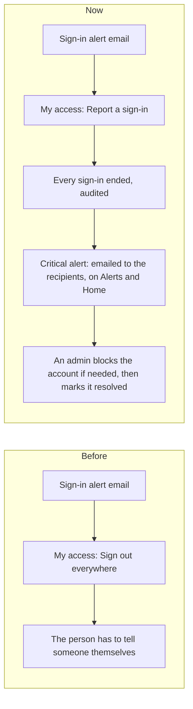

# Report a sign-in that was not you

> **In plain words.** The owner asked that staff be told about their sign-ins and be able to
> report a suspicious one. Until now a sign-in alert said "sign out everywhere, then tell whoever
> looks after access", which left the telling to the person. Now My access has **Report a
> sign-in**: one press, after a question, signs the person out of every browser and raises a
> critical alert that names them and the other browsers that were signed in. The alert is emailed
> to the alert recipients at once, sits on the Alerts page and Home, and is marked resolved once
> someone has dealt with it. The sign-in alert now points straight to that button.

## What changed

| Before | Now |
|---|---|
| The sign-in alert: "If it was not you, sign out everywhere at ..., then tell whoever looks after access" | "If it was not you, open ... and press Report a sign-in: it signs you out everywhere and tells whoever looks after access" |
| My access, Your sign-ins: Sign out everywhere only | Report a sign-in, then Sign out everywhere, in one sideways row; each asks first |
| Whoever looks after access heard only if the person told them | A critical alert, "x reported a sign-in that was not them", with when, that every sign-in was ended, the other browsers then open (name, country, time) and what to do: block the account from Users |
| Only a server error could be marked resolved by hand | A person's report (`report.*`) can be too; no check would ever close it |

Before, a report depended on the person knowing whom to tell. Now the press itself ends every
session and puts the report in front of whoever looks after access, with what they need to act.

## How it works

- `POST /api/iam/me/sign-ins/report` (`iam.self`): reads the other open sign-ins, ends every
  sign-in of the person, then hands the report to the `reported` option inside the same audited
  step (`iam.sign-in-reported`): a report nobody hears of never reads as done. Then the browser
  goes to Cloudflare Access's own sign-out, as Sign out everywhere does.
- The client template raises the alert with the words of `signInReportAlert`, keyed
  `report.sign-in.<person>.<when>`, so each report is its own alert.
- The alerts module lets `alerts.manage` mark a `report.*` alert resolved by hand; the Alerts
  table shows Mark resolved on it.

## Phone tests

P640 to P642, in [Phone tests owed: Users and access](../../docs/phone-tests-users.md).

## How it was checked

- iam: two browsers of one person, a report from one: both refused afterwards, `reported` told
  of the other browser only (Firefox on Android), the alert's words with and without other
  browsers, the audit row with how many were ended.
- alerts: a `report.*` alert marked resolved by hand.
- screens: Your sign-ins renders Report a sign-in first in a sideways row, both posted by the
  browser itself.
- The client template: a person reports, is signed out, the Owner finds the critical alert with
  Mark resolved on the Alerts page and resolves it.
- The full `pnpm verify` before the push (summary in the commit).
