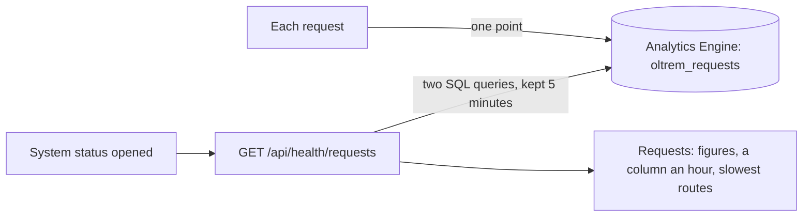

# System status shows the last day of requests

> **In plain words.** Since [the public addresses batch](2026-11-24-public-hooks-rest.md), every
> request writes one figure to Cloudflare's Analytics Engine, which is free. System status now
> reads them back. A new Requests section shows how many requests the portal answered in the
> last 24 hours, how many failed, the slowest hour, a column an hour, and the five slowest
> routes. Before, the page showed today's totals against the plan's limits, but nothing about
> how the portal behaved hour by hour or which page was slow.

## What changed

- `readRequests` (core-health) asks the SQL API twice: the last day grouped by hour (requests,
  failures at 500 and up, the 95th percentile time), and the five routes with the highest 95th
  percentile. Counts are weighted by `_sample_interval`, as Cloudflare's sampling asks.
- The answer is kept five minutes per isolate, so a page opened often asks once. It uses the
  portal key `KIT_OPS_TOKEN`, whose Account Analytics Read already covers the SQL API: no new key,
  binding or table.
- A missing key or a refusal is said in the section, never the key itself.

## How it was verified

- core-health 35 tests (the URL, the key's header, the dataset in both queries, text numbers
  read as numbers, five minutes kept, a 403 said, no key asks nothing); screens 12 in the
  switches file (the section, the reading, the 95th percentile, a slow route, the problem line).
  Full verify in the commit.
- Not done: a live portal, whose dataset starts filling once the fleet deploys the binding
  (phone test P560).
