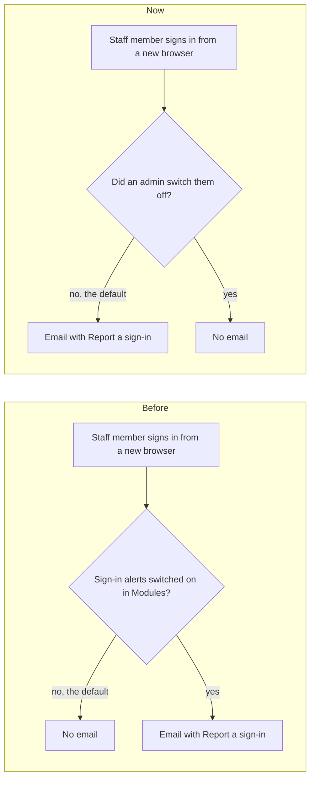

# Sign-in alerts on for everyone

> **In plain words.** Sign-in alerts email a person when their account signs in from a new browser
> or country. Until now they were off on every portal until someone found the switch on the
> Modules page, so most staff never heard of their sign-ins. On 24 November the owner picked "On
> by default": they are now on from the start on a new portal, and on every existing portal too,
> except where an admin had switched them on and later off again.

## What changed

| Before | Now |
|---|---|
| Sign-in alerts were one of the extras a new portal starts without | They are on from the start; the other extras that start off are unchanged |
| A portal that had saved its Modules switches kept them off | Migration `0085` takes them out of the saved "off" list, writes the settings history and moves the configuration version |
| | Kept off where the history shows the list without them since they existed: an admin had them on, then switched them off |

Before, the safe answer depended on someone finding a switch. Now every person hears of a new
sign-in unless an admin chose otherwise, and the email leads to Report a sign-in.

## How it works

- `iam.sign-in-alerts` no longer has `startsOff` in the kit's catalogue (core-config) or in the
  tool's copy (cli), so `EXTRAS_OFF_AT_FIRST`, the setting's default, no longer holds it.
- Migration `0085` (core-config) removes it from a saved `settings.parts_off` list unless a
  history row newer than migration `0067`'s (or any row, where `0067` wrote none) lacks it.
  Idempotent: its own history row lacks it, so a second run changes nothing.
- The mail sent is the existing sign-in alert, once per person and browser, through the portal's
  own mail and its limits.

## Phone tests

P643, in [Phone tests owed: Users and access](../../docs/phone-tests-users.md).

## How it was checked

- core-config: migration `0085` on a list saved before 2026-11-21 (taken out, the rest kept, the
  version moved, the history written once, a second run changing nothing), on a list first saved
  after (taken out), on a portal with no saved list (no row), and on a list where an admin had
  switched them off after they had been on (kept).
- core-config, cli and the client template: the extras a new portal starts without, the Modules
  answer and the audit rows' "switched on" lists, without Sign-in alerts.
- The full `pnpm verify` before the push (summary in the commit).
