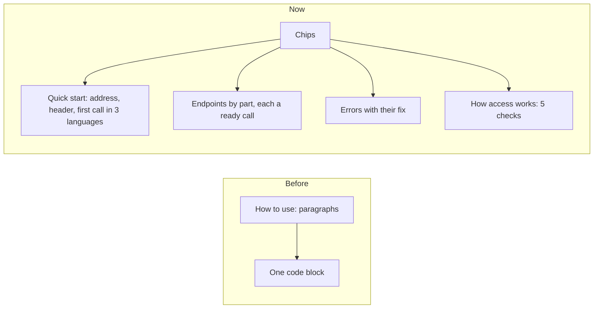

# API key pages made over

> **In plain words.** On 25 November the owner sent a screenshot of a key's How to use tab: "no one
> would ever touch docs like this". It was a column of grey text. Following how Stripe, Resend and
> GitHub lay out their API pages, the key pages are now coloured cards in sections: a Quick start
> with the address, the header and a first call in cURL, JavaScript or Python, each with its own
> Copy; the routes the key may call grouped by part, each opening to a ready call; the errors with
> their status in colour and what to change; and the checks a call passes, in order. The keys list,
> a key's Details and Calls got the same treatment.

## What changed

| Page | Before | Now |
|---|---|---|
| How to use (API keys and a key's page) | Plain paragraphs and one long code block | Chips that jump to four cards: Quick start (blue), Endpoints (green), Errors (rose), How access works (violet); methods and statuses as coloured tags; one language at a time; each route opens to its own cURL line |
| The keys list | Rows of text | Figures (working, ending within 7 days, never used, revoked or ended) above rows with a coloured key tile and a state tag |
| A key's Details | One list of facts | Figures (state, calls a minute, last used, ends) and two cards, Access and Key; the page's title is the key's name |
| A key's Calls | A chart and a text list | A Calls a day card over 7 days and a Latest calls card with method and status tags |
| A key's History | A text list | Each step with a coloured tag: made green, changed blue, rotated amber, revoked rose |
| Make a key | Every limit shown at once | Name, access type, calls a minute and end first; parts, start time and addresses under More limits |

**Impact on each part.** Screens: the API key pages only, no route or data change. Core UI: a
small `.ui-api` block of classes (tags, code with Copy, language switch, route folds, lists); the
stylesheet cap moves from 180 to 184 KiB. The rest of the portal is the design thread's sweep.

**How it was checked.** The screens API key test (the list's line and figures, each route of a
read-only key and no POST, a key's details, calls, history and every action through the API), the
stylesheet budget test, the list, Details, Calls and How to use looked at on this computer at 390
and 1280 pixels in the dark theme, then the full `pnpm verify`. Not checked: his live portal.
