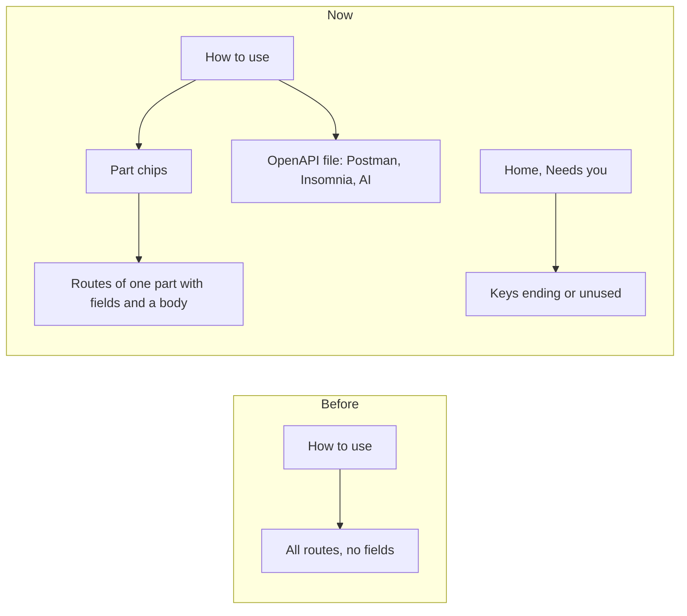

# API reference with fields, an OpenAPI file, keys in Needs you

> **In plain words.** The owner asked (25 November) for the best next steps in this area without
> waiting for him. Three gaps stood out for a system that calls the portal for years. How to use
> listed each route but not what to send, so a POST was guesswork: now each route lists its fields
> (kind, required or not, values and limits) and its example call carries a body of the required
> ones. There was no machine-readable description of the API: now How to use offers an OpenAPI
> file, the standard Postman, Insomnia, code generators and AI assistants read, for the whole
> portal or for one key's routes only. And a key could end, or sit forgotten in some system, with
> nobody told: now Home's Needs you names the keys that end this week and those unused for 90 days.

## What changed

| Before | Now |
|---|---|
| Endpoints grouped in folds, every route at once, a POST's example `-d '{ }'` | Chips for each part, one part's routes at a time; each route's Body (or Query) fields and an example body of its required fields, in cURL, JavaScript and Python |
| No description a tool could read | **OpenAPI file** in Quick start: OpenAPI 3.1, paths under /hooks/api, path parameters, query or body schema, the bearer key, the shared problem answer; on a key's page only what it may call |
| A key ending or unused for months told nobody | Needs you, for whoever holds `iam.keys.manage`: "1 API key ends this week", "1 API key unused for 90 days" |

**Why one part at a time.** The fields come from each route's zod schema, written out as JSON
Schema. Writing a whole portal's (about 280 schemas) took 16 to 33 ms in a measurement on this
computer, past the free plan's 10 ms of CPU a request. `GET /api/developer/reference?schemas=`
now takes `all` or module ids, keeps each written schema for the isolate's life, and How to use
asks for the one part it shows. Only the OpenAPI download asks for all, on a person's press.

**Impact on each part.** Developer: the reference's `schemas` query. Screens: How to use, two
download addresses (`/access/keys/openapi.json`, `/access/keys/:id/openapi.json`). IAM: one more
read in Needs you's batch, at most 20 rows. Core UI: two small rules. No table, setting or
resource.

**How it was checked.** The screens API key test (part chips, fields, the example body, the
schemas asked for, both OpenAPI files), the developer test (schemas for the module asked, none for
the others, a bad value refused), the IAM keys test (ending this week, unused for a quarter, used
again, nothing for someone who does not look after keys), How to use looked at on this computer at
390 pixels in dark, then the full `pnpm verify`. Not checked: his live portal, an import into
Postman.
