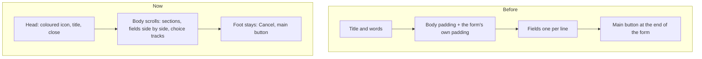

# Every dialog remade

> **In plain words.** On 25 November the owner sent the Make an API key pop-up and asked for every
> pop-up in the portal to be made over top to bottom: loose spacing, rows of options stacked one
> under another, nothing standing out, a dull dark panel. Now every pop-up has a coloured head with
> an icon and a close button, a body where only the fields scroll, and a foot that always shows
> Cancel and the one main button. Short fields sit side by side, a choice of one is one neat track,
> and long forms are split into parts under small headings. The owner named a palette he likes as
> the reference: the head takes a soft wash of the section's colour, with a thin line of it along
> the top.

## What changed

| Before | Now |
|---|---|
| A title and a line of words on the panel's colour, no icon, no close button | A head: the section's colour on an icon tile, the title, one line, a close button; a soft wash and a thin top line of the same colour |
| Each form added its own padding inside the body's, so everything sat far apart | One body padding; fields 16 px apart |
| The main button sat at the end of the form, scrolled away on a long one | The foot always shows Cancel and the main button; on a phone they share its width |
| Every field one under another | `FieldGrid` puts short ones side by side (Name and Access type, email and name) |
| Choices as loose chips that faded at the edges, cut by the dialog's sides | A choice of one is one track, the picked option raised in the dialog's colour; every option shows |
| A long form was one column | `DialogSection` splits it under small headings (Make an API key: Who it acts as, The key and its limits) |
| A field showed the browser's white ring | A field lights up in the dialog's colour |
| A dialog that removes looked like any other | `danger`: the tile and the main button red |

**Impact on each part.** Core UI: `Dialog` takes `form`, `submit`, `danger`, `icon`, `hue` and
`wide`; `DialogSection` and `FieldGrid` are new; the confirm and bulk dialogs are red with a warning
icon. Every module's dialogs moved their main button into the foot and got their icon; Add a
location and a location's Change became one form each (Remove posts the same form elsewhere).
Oltrem Mail's dialogs take the new shell and its colours as they are; their own buttons stay in
their bodies until Mail moves them.

## How it was checked

`pnpm verify` (the summary is in the commit). Looked at Add a customer, Claim an expense, Add a
location and Connect any other app on a local portal at 390 and 1440 px, light and dark, and Make an
API key's layout with the same classes. Not checked on a phone yet: P750 to P754.
