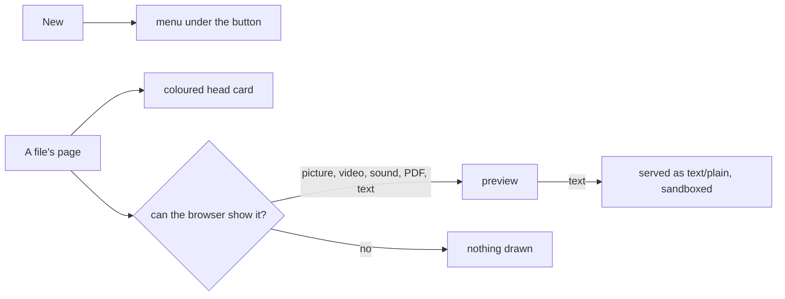

# Files: the file page, the details panel and New made over

> **In plain words.** The owner found three problems. The New menu opened in the top corner of
> the screen, far from the button. A blank box sat above Who has access on a file's page. And
> the file page and its details panel looked black and lifeless. Now New opens right under
> itself, the blank box is gone (text files such as `.md` show their text there instead), and
> the page and the panel have a head in the file's colour and a coloured tile on every card.

## What changed

| Part | Before | Now |
| --- | --- | --- |
| New | a pop-up with no position of its own, drawn in the screen's top corner | a menu under the button, at its end (the same menu as a row's), each row on a coloured tile (Upload files blue, Upload a folder amber, New folder green); on a phone the sheet from the foot as before |
| The blank box | the preview's frame drawn even when the preview had nothing to show (a `.md`, a spreadsheet) | a preview only when the browser can show one; a text file shows its text; otherwise no box |
| Text in place | plain text and JSON only | any text type, JSON, and a known text ending with no type, all served as `text/plain`, so an HTML file shows as its source and never runs; still sandboxed and never sniffed |
| The file page's head | name, line, buttons, and "In" on a line of its own | one card in a one-hue wash of the file's colour, a big tile, the name, then type, size, date and where it is on one line, the star, the menu and Download |
| The cards | grey heads | each head with a coloured tile: Who has access teal, Activity blue, Details slate, Links violet, Customers cyan, File requests teal, Versions amber, Keep rose |
| The details panel | a bare name and Close, a Type row, a Links row repeating Who has access, Activity as a loose list | the same coloured head with the type and size and Close; Changed and Where; Activity as a card |

## How it works now

## Verified

- The files tests on real D1: a `.md` with or without a type and an HTML file come back inline
  as `text/plain` with the sandbox; a file of no known text shape still downloads.
- The pages tests: no preview box for a zip, the text preview for a `.md` with no type, New as a
  menu with coloured rows.
- Headless screenshots: New open at 1440 px (dark) and 390 px (light); a file's page at 1440 px
  (dark) and 390 px (dark, a text file); the details panel at 1440 px (dark).
- The full verify chain (summary in the commit).
- Not checked: a real phone (P567 to P569).
