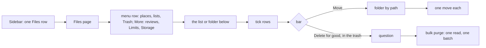

# Files: its menu in the page, the trash emptied, several moved, asking first

> **In plain words.** The owner asked for no Files rows in the sidebar: "move it completely
> somewhere else inside page". Files' places and lists are now the page's own menu row under its
> head, as Email's folders are, on a computer as on a phone. The sidebar keeps a single Files row.
> Then, on his word to go with every recommendation: the trash can be emptied, several files can
> be ticked and moved together, ending a link asks first, and a folder's search can look in all of
> Files.

## What changed

| Part | Before | Now |
| --- | --- | --- |
| A computer | the places, Starred, Recent, Shared with me, Shared links, Trash and, under More, the reviews, Limits and Storage, as rows under Files in the sidebar, with a Storage meter | the same menu, drawn by the portal as the row under the page's head (the design work's page menu): the places, lists and Trash as chips, More for the reviews, Limits, Storage and the meter |
| A phone | a row of chips of Files' own | the same page menu row; the separate phone chips are gone |
| The Storage meter | under the sidebar's rows | under More in the menu row |
| The trash | items deleted for good one at a time, from each one's page | tick rows and press Delete for good, or Empty the trash for all of them (up to 100 a press), each after a question; the route `POST /api/files/bulk/purge` reads the trees once and deletes in one batch |
| Moving several | only by dragging onto a folder | Move in the bar of ticked items; the dialog lists every folder by its path; the page script moves each ticked item |
| Ending a link or a share | at one press | a question first: what ends, and that it cannot be undone |
| A folder's search | this folder only | "Search all of Files" under the results and on an empty search |

## How it works now

## Verified

- The pages tests: the menu's rows, the current one, the reviews only for a manager, the meter;
  the folder page no longer draws a row of chips of its own; the trash's ticks, Delete for good
  and Empty the trash (its ids, to `/do/bulk`), none without the right; Move's folders by path,
  and its refusal without the script; the confirm before ending a link; Search all of Files.
- The files tests on real D1: many deleted for good, one not in the trash refused alone, the
  content gone, an audit row each; a person without the right refused.
- The frame test: Move sends one move per ticked item to the folder chosen.
- Headless screenshots at 1440 px (dark) and 390 px (light): the menu row, the bar with Move, the
  Move dialog, the trash with Empty the trash.
- The full verify chain (summary in the commit).
- Not checked: a real phone (P587 to P591).
