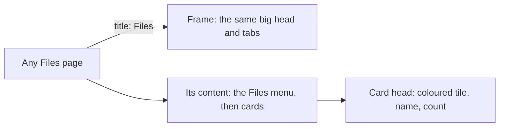

# Files: one title on every page, and colour in the lists

> **In plain words.** The owner found that Files changed shape from page to page: on the folder
> the title "Files" was big, but on Starred, Recent, Shared with me, Held for review, Shared
> links, Access review, Limits, Storage and a file's own page it turned small and a second
> heading ("Starred") took a line of its own. The lists also looked bland. Now every Files page
> keeps the same big "Files" title; the marked row or chip says where you are, and each list or
> part is a card headed by a coloured tile, its name and a count.

## What changed

| Part | Before | Now |
| --- | --- | --- |
| The page's title | each page's own name ("Starred", "Limits", the file's name), so the frame showed "Files" small above a second heading | always "Files", so the frame draws the same head as on the folder |
| Starred, Recent, Shared with me, Held for review | a plain list with grey icons | one card: a coloured tile (amber, blue, teal, rose), the list's name and its count; each row a tile coloured by the file's kind, the name and its location (and why, for a held file); Release and a trash button on a held file |
| Shared links | plain text rows, times in UTC | a card (violet tile) with a tile per kind (link, file request, customer share), times in the viewer's zone |
| Access review | plain rows, "Person: name", times in UTC | a card (green tile): the person's mark or a role or group tile, "name (Person)", times in the viewer's zone |
| Limits, Storage | a section heading and a long paragraph above each form | cards with a coloured tile head and a short note |
| A file's or folder's page | its name as the page's title, its line and buttons in the head | its tile, name, line and buttons head the content in a card, with where it is under them; Details shows the type in words, the time in the viewer's zone and the changer's name |

## How it works now

The frame (packages/screens) treats a page whose title is its section's name as the section's
own page and draws one head; any other title is drawn as a second heading under a small section
name. Files now always returns its section's name, and names each list inside its card. Nothing
in the frame changed; the same rule for every module is the design thread's.

## Verified

- The pages tests: each of the eight list and settings pages returns the title "Files"; the
  Starred card carries its name and amber tile; a file's page returns no title line or buttons
  in its head and shows its name, line and buttons in the content; Shared links and Access
  review as cards.
- Headless screenshots at 390 px (light) and 1440 px (dark) of Starred, Recent, Held for review,
  Shared links, Access review, Limits, Storage and a folder's page.
- The full verify chain (summary in the commit).
- Not checked: a real phone (P563, P564).
