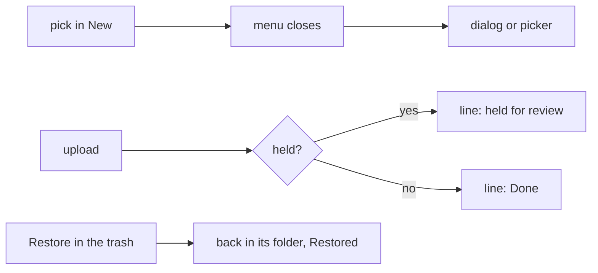

# Files: the whole page reviewed and fixed

> **In plain words.** The owner found New's third row cut off and asked for the whole of Files
> to be reviewed. Two reviews, one of the look at phone and computer sizes and one of every
> path a person takes, found the cause (a card that clipped anything sticking out of it) and
> 20 more problems. The owner then found a text file's preview filling the panel and squeezing
> the cards under it, the upload and trash boxes looking bad, and asked for the panel to slide in. This batch fixes the ones that belong to Files; the ones that belong to the
> shared frame went to the design work.

## What changed

| Part | Before | Now |
| --- | --- | --- |
| New and Sort | the folder card clipped what opened past its edge, so New lost New folder and Sort lost rows on a phone | nothing is clipped: the card keeps its rounded corners without cutting what opens over it |
| New after a pick | stayed open behind the New folder dialog or the file picker | closes as soon as a row is picked or files are chosen |
| The details panel on a phone | slid under the phone's top bar, its head hidden | starts below the bar; it gains Star, Open (view-only), Download, and Restore for a file in the trash |
| A text file in the panel | a tall box with the file's text squeezed Who has access and Activity into slivers (the owner's docs.md, whose text is a link) | the panel leaves the text to the file's page, where the box is a short 12 rem; no card in the panel ever shrinks, the panel scrolls instead |
| A PDF in the panel | a 70 % frame on a computer; on a phone a blank box (a phone's browser does not draw a PDF in a frame) | a short frame on a computer; on a phone no frame, just Open in a new tab |
| The panel opening | appeared at once | slides in from the right as the page behind dims, and slides out on Close; moving to another file or pressing Star in it keeps it still |
| The upload box | grey title, Stop alone on a line, an amber edge, a bar per file | one blue toast: an upload tile, the title and Stop on one line, each file's name with its percent and a thin bar; Done when sent |
| Moved to the trash | three lines and a big Undo on a line of its own | two lines: "Moved to the trash", then "Deleted for good in 30 days." with a small Undo beside it |
| Grid | one column on a phone, names cut to one line | two columns on a phone, names on up to two lines |
| List rows | Held drifted to the far right; a folder's size blank | Held right after the name; a folder's size shows a dash |
| Restore | landed on the trash again | lands in the file's folder with "Restored" |
| The trash | "Trash" alone | "Trash · " and the place's name |
| An upload into a place that holds new files | the line said "Done" | the line says it is held for review and who must release it |
| A kept file | Move and Move to the trash offered and then refused | not offered while the file is kept |
| A file that is gone | a dead end | a notice and "Back to Files" |
| A search with nothing found | no way back | "Clear the search" |
| Previews on a phone | 70 % of the screen | 45 % for a PDF, 30 % for text |
| A form the page does not know | made a folder anyway | refused with "That form is not known here" |

## How it works now

## Left for later

Delete for good and Empty trash; ticking many files to move; a Move dialog that shows paths; a
confirm before ending a shared link; search across all of Files; the overlap between Settings
and Limits; plain ids in Versions and Shared links; a drop onto a folder row. Frame items (chips
cut at the right edge without a hint, the room above the content) are the design work's.

## Verified

- The pages tests: Restore redirects to the folder with `done=restored`; the panel's star,
  unstar and release return to the panel; a kept file has no Move or trash; a missing file
  shows Back to Files; an unknown form makes nothing.
- The frame tests: New closes on a row's click and on a file pick.
- Headless screenshots at 390 px and 1440 px, light and dark: New with all three rows, Sort, the
  panel below the phone bar, the grid in two columns, the trash's heading.
- The full verify chain (summary in the commit).
- Headless shots of the upload box (phone, light; computer, dark) and the trash box (phone, dark).
- Not checked: the slide itself (a still shot cannot show it) and a real phone (P576 to P586).
