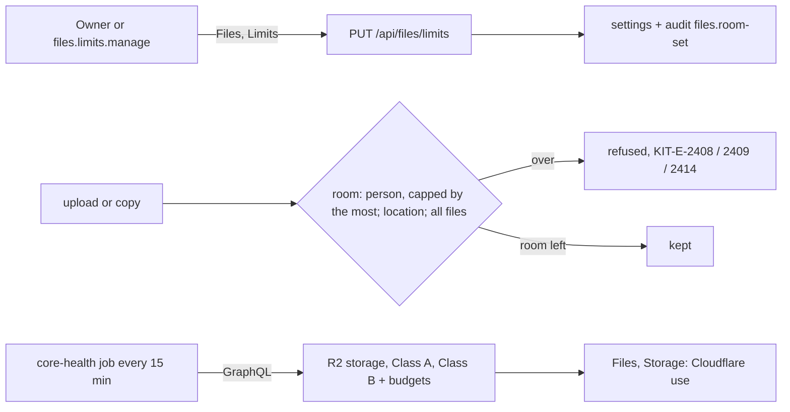

# Files: room for files and Cloudflare use

> **In plain words.** On the owner's ask for Files, Storage: one place to set how much all files
> may keep, how much each person gets by default, the most any person or role may be given, and
> when a bar warns; a permission of its own for it; and R2's storage, Class A and Class B
> operations, with the other Cloudflare budgets, shown right on the Storage page.

## What changed

| Part | Before | Now |
| --- | --- | --- |
| Room for all files | none: the bucket could grow past the free 10 GB | `files.total_room_mb`, 10 GB by default, over what the portal's own bucket keeps; an upload past it is refused (`KIT-E-2414`); a location kept in a storage connection is not counted |
| Room per person | a setting on the Settings tab | the same setting, also on Files, Limits |
| Most for one person | none | `files.person_room_max_mb` caps every person's and role's limit, 0 for no cap |
| Warning | none | `files.room_warn_percent`, 80 by default: a bar turns amber from there |
| Who may set them | an Owner, through the settings route | `files.limits.manage` (company-wide, fresh sign-in), an Owner and the Vendor always; one route, `PUT /api/files/limits`, one audited row `files.room-set` |
| People | listed with what each uploaded | sorted by the share of their room used, with a bar and a Change link to their own limit |
| Cloudflare use | only on Status | Files, Storage shows R2 storage, Class A (writes, lists) and Class B (reads) this month, and the other budgets, linking to Status |

R2 is measured by core-health's existing job with the same token (Account Analytics Read), from
`r2OperationsAdaptiveGroups` (from the first of the month) and `r2StorageAdaptiveGroups` (each
bucket's newest day). No new table, token or variable: three settings and one capability.

## How it works now

## Verified

- Files tests on real D1: the room for all files refuses an upload to the portal's bucket while a
  location in a storage connection takes it; the most per person caps a role's larger limit; the
  route saves all four, writes the audit row, refuses a person without the permission (403) and
  a warning share under 50 (422).
- Pages tests: the room form and its post, the capped note, the wording for someone who may not
  change it, the Cloudflare use card and its guard on an unknown answer.
- core-health tests: the query asks for the month and the week, counts Class A and Class B by
  action, and takes each bucket's newest day.
- The full verify chain (summary in the commit).
- Not checked: a real phone (P595 to P599), and the live GraphQL answer for R2.
