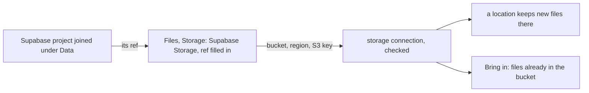

# Files: a Supabase project's storage

> **In plain words.** On the owner's ask to use the storage of a Supabase project already joined
> under Data from Files: Supabase Storage is now one of the services Files, Storage joins, and
> each project joined under Data is offered by name with its project ref filled in. A location can
> then keep its new files there, and Bring in makes the files already in the bucket Files' own.

## What changed

| Part | Before | Now |
| --- | --- | --- |
| Services Files, Storage joins | six (Amazon S3, R2, B2, Wasabi, Spaces, any S3) | seven: Supabase Storage, through its S3 API at the project's own storage host, path style, signed for the project's region |
| Filling it in | every field typed | a row of the Supabase projects joined under Data; pressing one fills the project ref; a secret is never filled from the address |
| The key's reach | each guide asks for a key to one bucket | the same, and Supabase's guide says plainly its key opens every bucket of the project past row level security, as Supabase gives no narrower one |
| Who sees the storage forms | an Owner | an Owner (the Storage view no longer follows the new room-for-files permission) |

No new table, token or variable. The key is a storage connection like the others: sealed, sent
only to the project's storage host, and checked (list, write, read back, refused without the key,
delete; versioning is a note, as Supabase's S3 has none).

## How it works now

## Verified

- Providers tests: seven storage definitions pass the contract; Supabase's address, its project
  ref pattern and the recipe's warning; the definitions route lists it.
- Files tests: the Storage view offers only Supabase projects joined under Data, by name and ref.
- Pages tests: the row of projects, the link that fills the ref, and a secret not filled from the
  address.
- The full verify chain (summary in the commit).
- Not checked: a real phone (P600, P601), and a live Supabase bucket.
