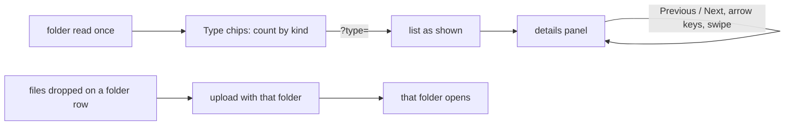

# Files: Type chips, Previous and Next, drop into a folder

> **In plain words.** On the owner's ask to keep improving Files the way the best file managers
> work: a folder can be narrowed to one kind of file with a row of Type chips, the details panel
> steps to the next or previous file without closing, and files dropped on a folder's row upload
> into that folder.

## What changed

| Part | Before | Now |
| --- | --- | --- |
| Finding one kind of file | read the whole list | Type chips under the folder's head: All, then Folders, Pictures, Videos, Sound, PDFs, Documents, Spreadsheets, Archives or Other, each with its count and colour, only the kinds the folder holds; shown once it holds two kinds; a search keeps the chosen kind |
| Looking through files | close the panel, press the next name | Previous and Next beside Close in the panel, in the list's order as shown (sorted, searched, filtered); the arrow keys on a computer, a sideways swipe on a phone |
| Dropping files from a computer | always into the folder on screen | onto a folder's row: into that folder, and the page opens it when done |

No new route, table or setting: the chips count the folder already read, and the panel's
neighbours come from the same list.

## How it works now

## Verified

- The pages tests: each kind named from its type and name; the chips with counts and a chip that
  filters; none for a folder of one kind; Previous and Next named for the neighbours and absent
  at the ends.
- The frame test: the arrow keys press Previous and Next (not while typing), a sideways swipe on
  the panel does, a vertical one does not, and files dropped on a folder's row upload with that
  folder.
- The full verify chain (summary in the commit).
- Not checked: a real phone (P592 to P594).
