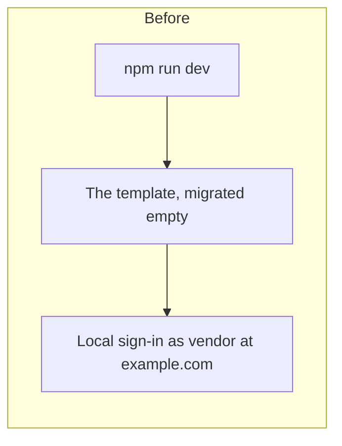
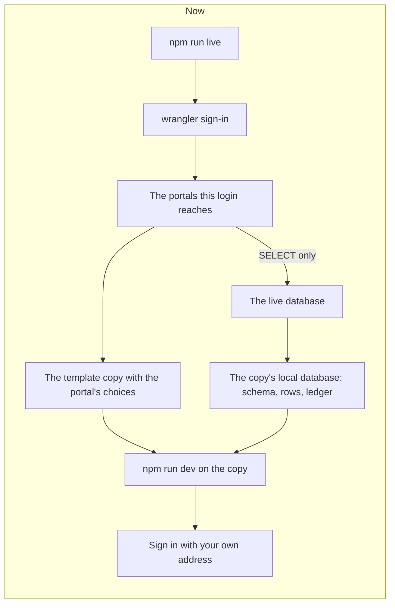

# A real portal on the Vendor's computer, and the rules for Antigravity

> **In plain words.** On 2026-11-25 the owner cloned the kit on his Windows computer to make
> visual changes with Google Antigravity, and asked that it imitate the live portal's features
> and data once he signs in to Cloudflare, with every rule, skill and instruction where
> Antigravity finds them. `npm run live` now signs in with wrangler, finds his portal, builds it
> with that portal's own choices and copies its data into the computer's own database, reading
> the live portal only. Antigravity now finds an always-on rule in `.agents/rules/` that sends it
> to ai.md, the kit's skills in `.agents/skills/`, and the owner's standing orders in rules.md.

## What changed, and why

| Part | Before | After |
|---|---|---|
| A portal on this computer | `npm run dev`: the template, empty, as any new client | also `npm run live`: a chosen client's portal with its modules and a fresh copy of its rows |
| Its data | made by the migrations; nothing from a live portal | read from the live database through Cloudflare's API (SELECTs only) into the local one |
| What it can touch | only this computer | still only this computer: no binding is remote, the live keys do not open |
| Antigravity | `AGENTS.md` only | also `.agents/rules/oltrem.md` (always on) and `.agents/skills/`, generated by `pnpm agents:write` and held to their sources by `pnpm check:agents` |
| The owner's standing orders | in agents' memories and chat only | a section of rules.md, read by every tool |

Remote bindings (wrangler's `remote: true`) were the other way to show real data, and were
declined: every save, upload or job of the local copy would then write to the live database,
bucket and queue, and the local cron tick would run the live portal's jobs from this computer.
A copy shows the same rows and cannot change the live portal.

## How it worked before and how it works now

Before, the portal on a computer was always a new, empty client.

Now the same command line finds the portal the way the fleet does, copies its rows and the
migrations ledger, and starts the copy with the template's own `npm run dev`, which applies only
the migrations newer than the live portal.

## Impact on each part

- **`@oltrem/cli`:** new `live` command (`src/live.ts`); `fleet.ts` exports its query helper and
  builds a copy in a folder it is given, linked with a junction so Windows needs no
  administrator rights.
- **The kit's root:** `npm run live`; `.live/` ignored by git.
- **Client portals:** unchanged. A copy reads each table once a start, well inside the free
  plan's daily reads.
- **Agents:** `pnpm agents:write` also writes the Antigravity rule and the skill copies.
- **Not copied:** the bucket's files and Oltrem Mail's search index.

## How it was verified

- `packages/cli/test/live.test.ts`: literals; the schema plan (system, Cloudflare and FTS shadow
  tables left out, indexes and triggers after the rows); a round trip on node:sqlite with keys
  between tables, a trigger, a view, a blob, quotes, a contentless FTS5 index and more than two
  pages of rows, every row the same and no trigger fired; a table that cannot be read; the
  sign-in key; the whole run against a stand-in of Cloudflare's API that fails on any write,
  signing in first, the copy named for the portal and never on its address.
- A real round trip with wrangler on the template's full schema: every migration applied to one
  local database, read back through the same code, loaded with `wrangler d1 execute --local
  --file` into a new one, and every table's row count compared.
- `pnpm check:agents` refuses an edited skill copy and passes after `pnpm agents:write`.
- The full verify chain (summary in the commit).
- Not verified here: a run against the live portal with the owner's own login, and a run on
  Windows. Both are the owner's first `npm run live`.
