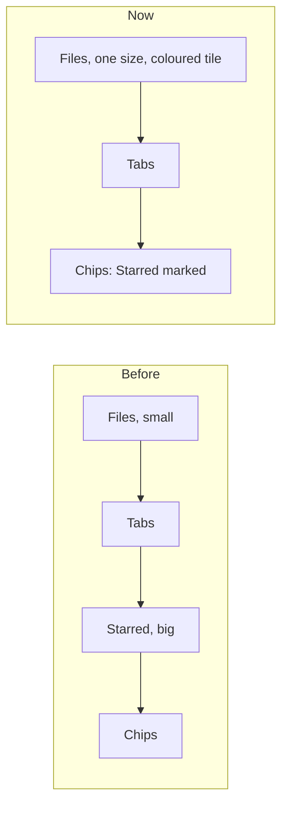

# One title, no wrapping, a lighter dark theme

> **In plain words.** On 25 November the owner sent two phone screenshots of Files: on Starred the
> page's name "Files" shrank and "Starred" sat on a line of its own as a second title, both pages
> looked very dark and bland, and words broke onto new lines. Now a view of a tab keeps the tab's
> own head, so the title is the same size in the same place on every page; the words on buttons and
> chips stay on one line; the dark theme is lighter and tinted, and each section's coloured tile
> shows beside its name on a phone too.

## What changed

| Before | Now |
|---|---|
| A view of a tab (`/files?show=starred`) drew the section's name small, then the view's name as a second title under the tabs | The tab's own head: the section's name at its one size; the chip shows which view is open |
| A record (a user) drew the section's name small above the tabs | The section's name at the same size; the record's name is the first line under the tabs |
| Button and chip words could break onto two lines on a narrow phone | `whitespace-nowrap` in every button, `white-space: nowrap` on every chip |
| Dark greys near black (page 15%, card 19.5% lightness) | Page 19%, card 23.5%, raised 28%, border 33%, with more blue tint; the same in every colour look |
| On a phone the section's coloured tile was hidden | It shows at 28 px beside the name |

**Impact on each part.** Screens: the page head and the looks' dark greys. Core UI: the button and
chip rules and the dark tokens. Every page follows, as all of it is in the shared frame.

**How it was checked.** The client template's screens test, the screens and core UI tests, Files,
Starred and a user looked at on this computer at 390 pixels in the dark theme, then the full
`pnpm verify`. Not checked: his live portal.
