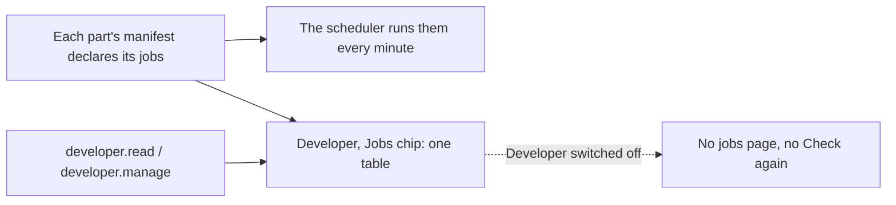
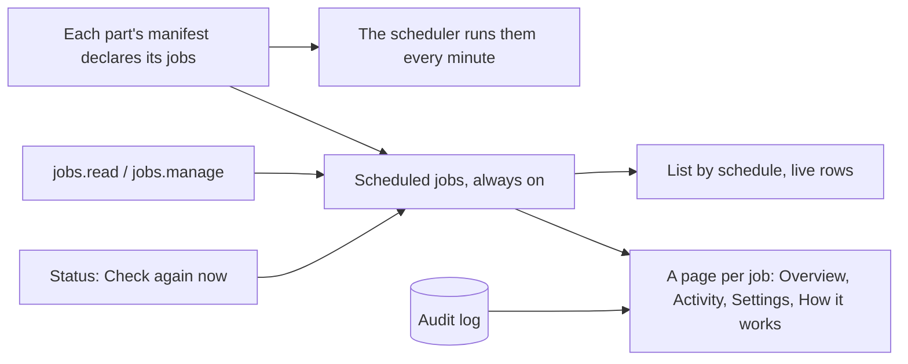

# Scheduled jobs: a page of its own for every job, now and later

> **In plain words.** The owner asked for a page that watches every scheduled job Oltrem has, and
> every one added later, made like the Scheduled jobs page of the portal he admires, and well
> permissioned. The jobs were already found by themselves (each part declares its own), but they
> sat in a corner of Developer, a part that can be switched off, behind Developer's permissions.
> They now have their own part, **Scheduled jobs**, always on, with two permissions of its own,
> a list grouped by schedule with live rows, and a page for each job with four tabs.

## What changed

- **A new part, `@oltrem/jobs`** (`modules/jobs/`), always on (`core` in the Features list), in
  the sidebar under Admin as **Scheduled jobs**, at `/jobs`. Its README holds the page, the
  routes and the words.
- **Two permissions on bit plane 33:** `jobs.read` to look and check for work, `jobs.manage` (with
  a fresh sign-in) to run soon, pause and resume. Both are read at the company. Someone who may
  only look is told once which permission the rest needs.
- **The list**, after the model page: filters (All, Needs a look, Paused, Active) with counts,
  a search, five figures (active, needs a look, paused, the last 24 hours, the next tick), then the
  jobs grouped by schedule in words, each row its name, part, status (a dot and a word, in the
  model's order: Off, Paused, Failing, Held back, Running, Sleeping, Active), last run that keeps
  work apart from a look ("Worked", "Looked", "Failed" in red), next run or what it waits for, and
  one bar an hour for the last day. The figures and rows refresh every minute while the page is
  open.
- **A page per job** with Overview, Activity, Settings and How it works. Activity reads the hours
  it ran in and its changes by hand from the audit log, with no new table and no new write.
- **A name for each job:** `JobDefinition.title`, optional; without it the page uses the summary's
  first clause, so every job of every module, a client's own included, has a name today.
- **Moved out of Developer:** its jobs routes, page, check and error. Developer is now webhooks
  and the API reference (version `0.2.0`, its labels say so). System status's **Check again now**
  goes through `/api/jobs`, so it no longer disappears when Developer is switched off.
- **Renamed:** the audited actions are `jobs.run`, `jobs.pause`, `jobs.resume` (the old
  `developer.job-*` rows still read as a job's activity and in the audit log's words); the check
  is `jobs.runs` (was `developer.jobs`); the error is `KIT-E-4201` (was `KIT-E-2605`).

### Before

The jobs were listed in one flat table in Developer, behind the webhooks' permissions, and
vanished with Developer.

### After

The same manifests feed a part of its own; its permissions are its own; the audit log it already
wrote gives each job's history.

## Impact

| Who or what | What it means |
|---|---|
| The Owner and the Vendor | they hold both permissions already; nothing to grant |
| A role that had `developer.manage` to run jobs | it keeps the webhooks; to run and pause jobs, give it `jobs.manage` on Users and access, Roles |
| A client's own module | its jobs show on the page with no change; a `title` names them better |
| A bookmark to `/developer` | opens the webhooks; `/developer?show=webhooks` still works |
| The free plan | the list reads what the Developer page read; a job's page adds one indexed audit read; nothing is written by looking |
| The database | no migration, no table |

## How it was verified

`pnpm verify`, the full chain, with the summary in the verification log. The new module's tests
run the routes through the pipeline beside the IAM module on real D1 (both permissions at the
company and refused at a place; a failing run, run soon, pause and resume audited and read back,
the old action names included; a switched-off part shown Off, refused with `KIT-E-4201`, passed
by on Status; check for work), pin every sentence of `src/words.ts`, and render both pages (the
groups, the filter and search, the permission line, the four tabs, the forms). The client
template's screens test opens `/jobs`, a job's page and its Settings tab; the worker test reads
`jobs.runs` among the checks. Not verified: the pages on a real phone (P720 to P725 in
[the System list](../../docs/phone-tests-system.md)).
