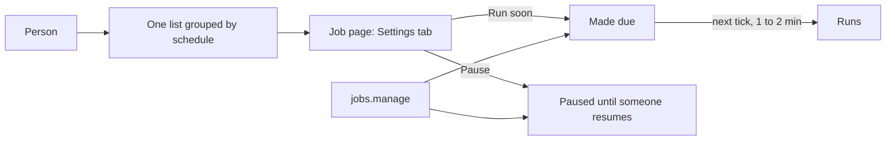
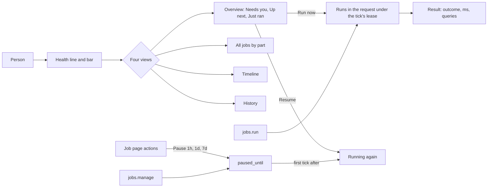

# Scheduled jobs remade: health first, four views, Run now and a pause that ends

> **In plain words.** The owner did not like the first Scheduled jobs page: its look, its
> options and how slow it felt to act on a job, and asked for it to be made completely
> differently. The page now opens on one line that says whether the jobs are fine, a bar with a
> segment a job, and what needs you, with the fix in place. Four views replace the one long list,
> each part has its own colour, and a job's page has its actions at the top. **Run now** runs a
> job at once and says what it did; a pause can end by itself; running and pausing are now two
> separate permissions.

## What changed

- **The page** (`/jobs`) opens on the health: "All 31 jobs are fine" or how many need a look,
  the next tick, the hours of work today, a segment a job in its state's colour, the three counts
  as links. Then four views in a sideways row:
  - **Overview**: **Needs you** (failing, held back or paused, each with Run now or Resume in
    place), **Up next**, **Just ran** with each run's time and queries.
  - **All jobs**: search and filter chips, a section a part in that part's colour, one compact row
    a job (no tall cards on a phone).
  - **Timeline**: every job's last 24 hours as one grid.
  - **History**: the newest 50 changes by hand to any job.
- **A job's page**: the actions first (**Run now**, **Check for work**, **Pause** or **Resume**),
  then five tabs: **Overview**, **Runs**, **Schedule** (the next five runs and **Run soon**),
  **Access** (the three permissions and whether you hold each) and **About**.
- **Run now** runs the job inside the request, under the same lease the tick takes, so it never
  runs twice; the schedule is kept. The page then says "It ran and worked (12 ms, 3 queries)", or
  that it found nothing, failed or was already running. Audited as `jobs.run-now` with its result.
- **Pause for a while**: an hour, a day, a week or until resumed. The end is kept in a new column,
  `paused_until` (migration `0094`, on the scheduler's existing table), and the first tick after
  it resumes the job.
- **A third permission**, `jobs.run` (operate): Run now, Run soon and System status's Check again
  now. `jobs.manage` keeps pause and resume, with a fresh sign-in.

## How it worked before and how it works now

### Before

One list, every job in it. The only way to run a job was to make it due and wait for the next
tick; a pause lasted until someone remembered to resume it, and one permission covered both.

### After

What needs a look is the first thing on the page, with its fix beside it. A run happens while you
watch, and a pause can end on its own.

## Impact

- **The portal**: one new column on the scheduler's table, no new table, binding, variable or
  secret. The tick reads paused rows only when their end has passed. History is one indexed read
  of the audit log.
- **Roles**: the Owner and the Vendor hold all three permissions. A custom role that had
  `jobs.manage` for Run soon needs `jobs.run` added; the page says which permission is missing.
- **Clients**: the fleet gets it on the next kit push; migration `0094` is applied by the deploy.

## How it was verified

- The scheduler's tests: a pause for a while ends at the first tick after its end and not before;
  Run now answers null for an unknown job, ok, idle and failed with the schedule kept, and busy
  while a tick holds the lease.
- The jobs module's tests: the three permissions and eight routes, Run now refused without
  `jobs.run` and with the part off, the timed pause, every sentence of the words, each view and tab.
- The client template's screen tests with the new tabs and redirects.
- The pages drawn with the local portal at 390 px (light) and 1280 px (dark): no sideways scroll,
  the hours bars visible on a phone, Run now, Pause for a day and Resume walked through.
- `pnpm verify`, green before the push.
