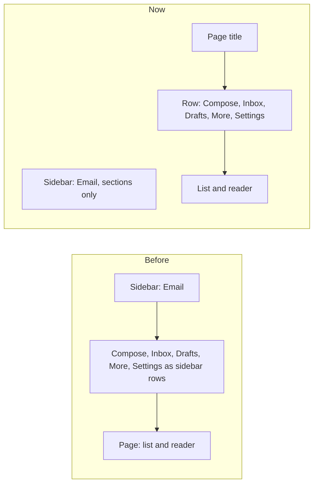

# A solid sidebar, brighter colours, and page menus inside the page

> **In plain words.** On 25 November the owner said the sidebar looked grey and a little blurry,
> asked for a professional sidebar he would want to use, and asked for Email's and Files' own
> rows to leave the sidebar for the page. Now the sidebar is one solid colour (white in the light
> theme, deep navy in the dark one) with bright icons in each group's colour; Email's folders are
> a row of chips under the page's title; every group colour across the portal is brighter; and
> API keys is a tab of Integrations, where people look for anything API.

## What changed

| Before | Now |
|---|---|
| Sidebar tinted with the portal's colour over grey | One solid colour of its own, light and dark (`--ui-side`, `--side-fg*`) |
| Each icon on a pale tile; the page on screen a solid tile | Each icon bare in its group's colour; the page on screen tinted, with a marker at its edge |
| Group names tinted, fold arrow always shown | Group names dimmer after a dot of their colour; the arrow shows on hover or when folded |
| Email's Compose, folders, labels and Settings as rows under Email in the sidebar | A row under the page's title: Compose, folders and labels as chips with counts, More, Settings |
| Group colours muted (about 52% lightness in light) | The 600 step in light (700 for amber), the 400 step in dark |
| API keys a tab of Users and access | A tab of Integrations, beside Apps, Email services and Developer |

Before, the frame drew the page first and hung its menu under the section's row, so a new count
redrew the whole sidebar. Now the frame draws the page's body, then the head with the menu as a
row under it; the sidebar no longer changes with a folder or a count, so the browser keeps it.

**Impact on each part.** Core UI: the colour tokens, the sidebar rules, `PageMenu` in place of the
sidebar's menu list, and `MailShell` without its phone folder button inside the frame. Screens:
the frame, the sidebar, API keys' place, and a part's options kept on its own set's Settings tab
(API keys' module stays on Users and access's). Files left the sidebar on its own thread the same
day. Every page takes the brighter colours.

**How it was checked.** The core UI and screens tests (the theme's contrast pairs pass with the
new colours: 3:1 for every group colour on the page and on a card), the client template's screens
test, Email and API keys looked at at 1440 and 390 pixels in light and dark and on the closed
rail, then the full `pnpm verify`. Not checked: his live portal.
