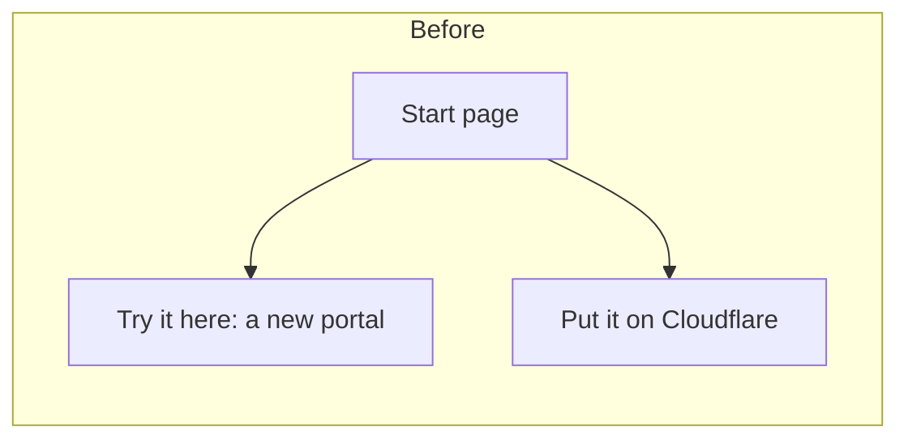
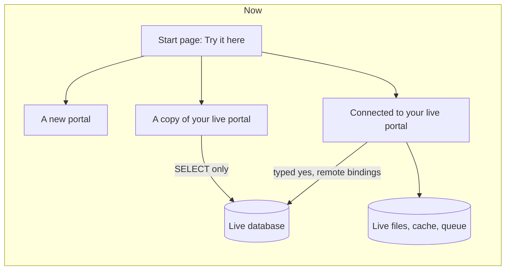

# The start page for local testing, and a portal connected to the live one

> **In plain words.** Later on 2026-11-25 the owner asked that the kit on his computer focus on
> testing there: no "Put it on Cloudflare" on the start page (he chose to hide it, not delete
> it), a double-click file, and a way to test against the live portal itself. The start page's
> Try it here card now asks **which data**: a new portal, a copy of the live one, or the live one
> connected. `live-windows.cmd` updates the kit and starts the copy in one double-click.
> `npm run live -- --connected` uses the live database, files, cache and queue after a typed yes.

## What changed, and why

| Part | Before | After |
|---|---|---|
| The start page | three cards: this computer, try it here, put it on Cloudflare | two: this computer, try it here (which data, then who may open a new one) |
| Putting a portal live | a card on the start page | `npm run setup` or `npm run deploy` only; the fleet updates live portals on every push |
| Testing on live data | a copy only (`npm run live`) | also connected: the live resources themselves, after a typed yes |
| Starting on Windows | `start-windows.cmd`, then a choice | also `live-windows.cmd`: update, install, `npm run live` |

Connected is guarded three ways. It refuses while the live database is behind this kit's
migrations, since the pages would expect columns it lacks. It asks for a typed yes, which the
start page's choice gives since its words say what it does. And it keeps on this computer what
would act twice or wrongly: no queue consumer (the live portal handles the events with its own
keys), no cron tick, and no KEK, so no key is sealed with one the live portal cannot open.

## How it worked before and how it works now

Before, the start page offered an empty portal or a deploy.

Now the same card picks the data. A copy reads the live database once a start; connected reads
and writes the live resources while it runs.

## Impact on each part

- **`@oltrem/cli`:** `oltrem live --connected [--yes]`; `fleet.ts` exports its API helper; the
  start page's card asks which data.
- **The client template:** `npm run dev -- --connected` leaves the local database, the KEK and the
  local tick alone.
- **The kit's root:** `live-windows.cmd`; the start page's choices without `deploy`.
- **Live portals:** a connected session reads and writes them as the live Worker would.

## How it was verified

- `packages/cli/test/live.test.ts`: the resources read from the Worker's bindings; the template's
  wrangler.jsonc made remote with its consumer left out, and nothing connected when its shape
  differs; the migrations the live portal lacks; the whole connected run against a stand-in of
  Cloudflare's API (refused when behind, refused without the yes, connected with it or with
  `--yes`, no write ever reaching the live database).
- `scripts/launch.test.mjs`: the live file's steps; the start page's six choices, none of them a
  deploy. `scripts/template-dev.test.mjs`: `--connected` taken out before wrangler.
- `wrangler deploy --dry-run` accepted the connected wrangler.jsonc and listed every binding.
- The full verify chain (summary in the commit).
- Not verified here: a connected run against the live portal, and the start page on Windows.
