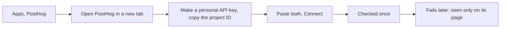
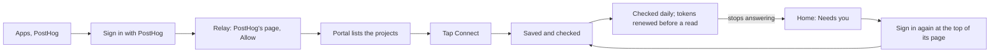

# Sign in with PostHog and Google Analytics, checked daily

> **In plain words.** The owner's ask of 26 November: on the Apps page, "1 Sign In which is
> modern, smart, smooth and easy to setup and 2nd is manual with API key", checked "frequently or
> daily", and "if any request fail anytime just request user to Login ... again". PostHog and
> Google Analytics now connect by signing in: press Sign in, allow read-only access on the app's
> own page, pick the project or property, done. Nothing to copy or paste. The key is still there,
> folded under "Or connect with a key". Each connection is checked once a day; when one stops
> answering, Home says so under Needs you and its page puts Sign in again at the top. The tokens
> renew by themselves before they run out. In the same batch: a card never stretches to the
> height of a taller card beside it, anywhere in the portal (the owner's screenshot of the Data
> cards), and "Everyone's links" left the top of the Apps page for a quiet link in its Calendar
> part.

## What changed

| Part | Before | Now |
|---|---|---|
| Connect relay | Slack, Discord, Google Sheets, Supabase, Airtable | also `posthog` (no app registered: the client id is a document the relay serves at `/client/posthog`, PKCE) and `google-analytics` (the Vendor's Google app, `analytics.readonly`, offline access, renewed at `/renew/google-analytics`) |
| Connecting PostHog or Google Analytics | paste a personal API key, or a service account's JSON key | Sign in with PostHog or Google first; the key folded under it |
| Picking the site | typed: the project ID or the property ID | listed: PostHog's projects in both regions, narrowed to those allowed; Google's GA4 properties; one tap to Connect |
| Tokens | none | sealed like a key; renewed five minutes before they end, just before a read; a refused renewal says "sign in again" |
| Checking | when someone opened the page or pressed Check now | also a job every three hours that checks up to three connections not checked for 20 hours, so each is checked about once a day |
| A connection that stops answering | seen only on its page or under Connected | Home, Needs you: "PostHog stopped answering", opening the page with Sign in again at the top |
| Cards side by side | a card in a row grew to the tallest one's height | each card keeps its own height (`.ui-tgrid`, `.ui-grid`, `.ui-al-panels`) |
| Everyone's links | a button beside the Apps title | "Links your team made" in the Calendar part, and above the Calendar and Spreadsheets filters |

No table, migration, binding, secret, variable or dependency. Google reuses the existing
`GOOGLE_CLIENT_ID` and `GOOGLE_CLIENT_SECRET` of the relay (R-05); PostHog needs no secret at all.

## Impact on each part

- **relay:** two entries, the client document route, and Google's renewal handing back the
  refresh token Google keeps. It must be deployed again for the new entries to work.
- **providers:** PostHog's and Google Analytics' key is optional; the sign-in's fields are named
  in `SIGN_IN_FIELDS`, never typed; `setCredential` can replace a credential whole.
- **connect:** the way back lists the sites and holds the tokens in a sealed cookie until one is
  picked; the route that saves it; renewal in the readers; the daily job and Home's line; the
  Connect and connection pages put Sign in first.
- **core-ui:** three grid rules, with a theme test that refuses any grid of cards that stretches.
- **template, analytics:** nothing: the job and Home's line arrive through the connect module.

## How it worked before

## How it works now

Signing in goes the same way as the one-click apps: the trip is sealed to the person and the
portal, the relay alone talks to the service, and the tokens come back sealed. They wait in a
sealed cookie for ten minutes while the person picks a site, and are saved only on the server, so
no token ever reaches the browser. A renewal that two requests start at once is kept by the first;
the second reopens the connection and reads the new tokens.

## How it was verified

- `packages/relay/test/relay.test.ts`: the client document, PostHog's start without a secret,
  Google's offline start, and a renewal that hands back the kept refresh token.
- `modules/connect/test/analytics.test.ts`: the sign-in's fields never listed or typed; PostHog
  signed in across both regions, renewed before a read, a client of another relay refused, a key
  pasted over it dropping the tokens; Google's refused renewal, Home's line, signing in again into
  the same connection, and the daily job.
- `modules/connect/test/pages.test.ts`: Sign in first with one main button and the key folded; the
  way back through the pick page to the connection; a refused trip back on the Connect page.
- `packages/core-ui/test/theme.test.ts`: every grid of cards starts its cards at the top.
- A security review (read only) before the push found a signed-in connection's project or
  property could be changed by a field alone, pointing someone's sign-in at another site it
  reaches; that is refused now, with a test. It also noted an app's answer was read whole with no
  size limit (now 2 MB) and that the relay's renewal does not check who calls (left, in the
  relay's README).
- `pnpm verify`, quoted in the commit.
- Not checked: a live sign-in with PostHog or Google (the relay is not yet deployed with the new
  entries, and Google's app needs the Analytics APIs and its new return address); phone tests
  P933 to P939 are owed.
