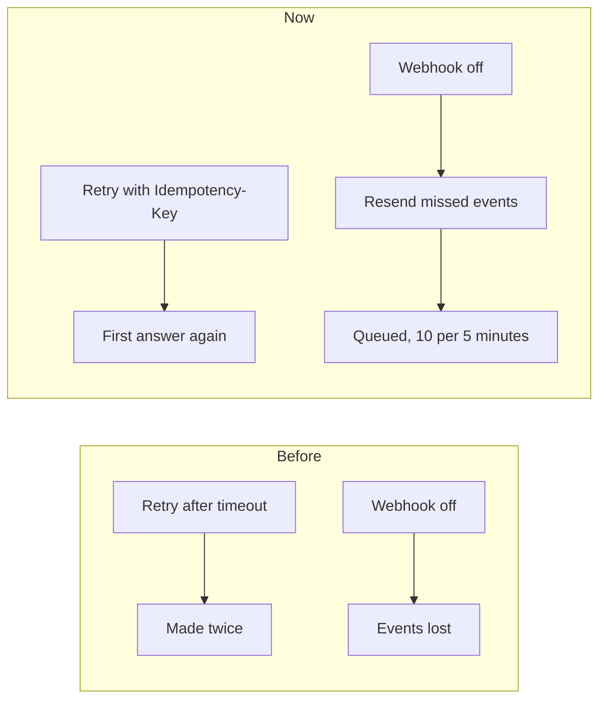

# API keys made safer, retries without doubles, webhook replay

> **In plain words.** The owner asked (26 November) to carry this area on with several agents
> at once. Five reviewers (free plan, security, words, phone, API practice) read the key pages and
> the call path. What they found is fixed here. A key's account could be given a wider role from
> Users, around its key: now only the key's own page changes its access, and making or changing
> keys can ask for a recent sign-in. A system that retried a call after a timeout could make a
> thing twice: it can now send an `Idempotency-Key` and get the first answer back. A webhook that
> stopped after failures lost what happened meanwhile: Resend missed events sends it again. And
> the pages say "requests", "rate limit" and "permissions", the words other APIs use.

## What changed

| Before | Now |
|---|---|
| A key's service account could take a role through Users, overrides or a group | Refused with KIT-E-2018 "Change this on the key's page"; only the key's page changes it |
| `iam.keys.manage` asked for no recent sign-in | It does, when the portal's recent sign-in window is on |
| A retried POST, PATCH or DELETE ran twice | With `Idempotency-Key` the first answer comes back (`Idempotent-Replayed: true`) for 24 hours; another body is 422, one still running is 409 (KIT-E-0409) |
| Rate limits shown only on refusal | `RateLimit-Policy` on every key answer, `RateLimit` on a 429; a key over its limit writes at most one audit row a minute |
| Rotate kept the old secret a day by default | It stops the old one now unless a while is picked; secret pages are `no-store` |
| A webhook's new secret broke receivers at once | Rotate secret keeps the old one signing for 1 hour, 1 day or 1 week, both signatures in the header |
| Events missed while a webhook was off were lost | Resend missed events queues up to 1,000, sent ten every five minutes; each event body has `id` and `v` |
| One OpenAPI file of every route | One file per section (the one open under Endpoints), so no request writes all 280 schemas |

**Impact on each part.** Core HTTP: the idempotency step and the headers. Core errors: KIT-E-0409.
IAM: table `iam_idempotency` (migration 0101), the daily job `iam.tidy` that prunes it, the
service-account check, the sign-in rule, error words. Developer: migration 0102 (the old secret's
columns, the last sent and stopped event), Rotate secret, Resend missed events. Screens and core
UI: words, the rotate default, per-section files, a chevron on endpoints. Cost: a call with the
header is one read and up to two writes; without it, nothing.

**Checked.** Tests for each part, each failing without its change: core-http
(replay, 422, 409, size, a day old, store failure, headers, one row a minute), IAM (the three
refused paths, Change access still working, the old sign-in, the words, the store on real D1),
developer (both signatures, `id` and `v`, replay once and capped at 1,000), screens (words, the
rotate default, the section files, `no-store`), the client template, then the full `pnpm verify`.
Not checked: his live portal, a real receiver taking two signatures.
