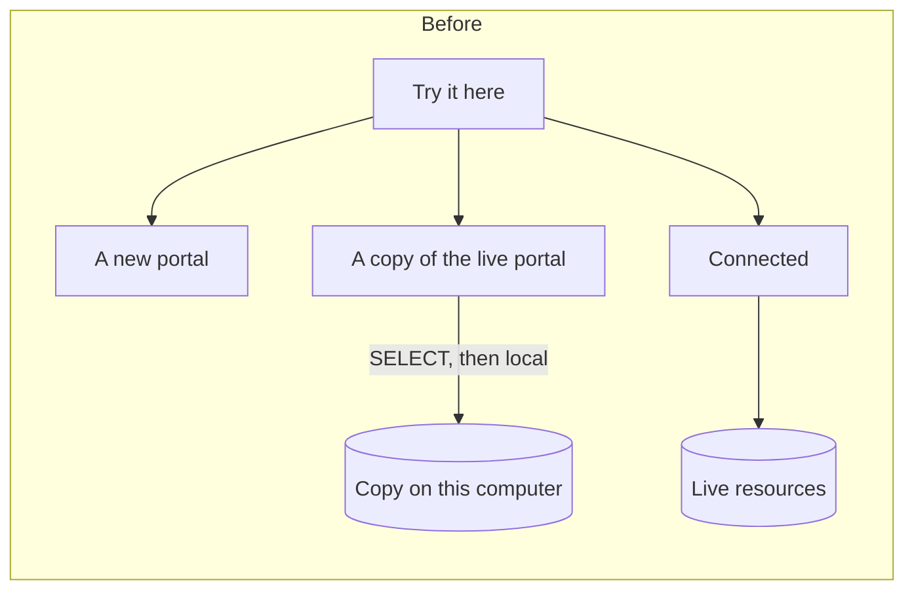
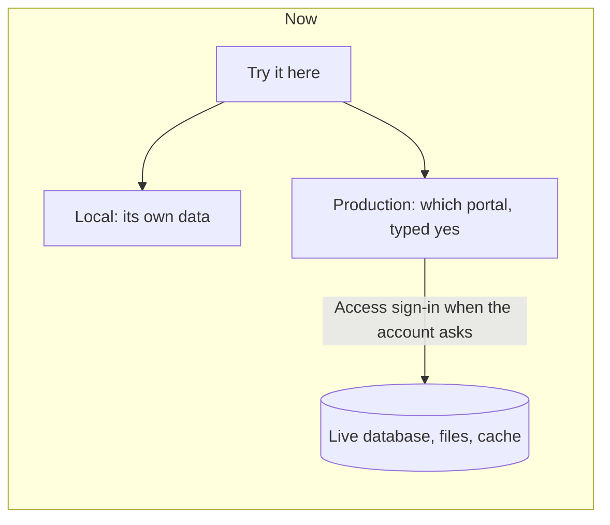

# Local or Production: no copy of live data on a computer

> **In plain words.** On 2026-11-26 the owner ruled that a client's live data is never copied to a
> computer: a copy is a data integrity and loss prevention risk. The start page's Try it here now
> offers two ways: **Local**, a new portal with its own data, and **Production**, the real portal
> run on this computer against its live database, files and cache after a typed yes. The copy
> made by `npm run live` since the day before is gone. Production also gets past Cloudflare
> Access on an account that guards every Worker, by a sign-in with the person's own Cloudflare
> login, and it always asks which portal, with another Cloudflare login one choice away.

## What changed, and why

| Part | Before | After |
|---|---|---|
| Which data | a new portal, a copy of the live one, or connected to it | Local or Production |
| `npm run live` | a copy of the live database in the local one; `--connected` for the live resources | the live resources, after a typed yes; there is no copy |
| Which portal | asked only when the login reached several | always asked, with **Another Cloudflare login** last |
| An account whose Access guards every Worker | wrangler's link to the live resources turned away | a browser sign-in through Access with the person's Cloudflare login; `cloudflared` installed by itself on Windows and macOS |

The owner was offered a shared service token for the account and declined it: nothing is added to
a client's Cloudflare account for local runs. wrangler already signs in through Access with
`cloudflared` when it thinks a person is at the keyboard, so the dev script tells it so on
Production; its output still reaches the start page, and no question can reach it.

## How it worked before and how it works now

Before, a copy put every row of the client's database on the computer.

Now the live data stays in Cloudflare; Production reads and writes it in place while it runs.

## Impact on each part

- **`@oltrem/cli`:** `oltrem live [--portal W] [--yes]` connects or stops; the snapshot code and
  `--connected` are gone; the start page shows Local and Production.
- **The client template:** `scripts/dev.mjs --connected` runs wrangler told a person is there,
  waits up to six minutes for an Access sign-in, installs `cloudflared` when wrangler asks for it.
- **The kit's root:** the start page's choices are five; `live-windows.cmd` starts Production;
  rules.md's standing order says Local or Production, never a copy.
- **Live portals and accounts:** nothing added; a Production session reads and writes as the live
  Worker would.

## How it was verified

- `packages/cli/test/live.test.ts`: the portal always asked, another login signing out and in;
  the whole Production run against a stand-in of Cloudflare's API (refused when behind or without
  the yes, connected with it, the choices written in, the portal's address left out).
- `scripts/template-dev.test.mjs`: a child run with the preload sees a terminal; the installer
  for each system; a missing `cloudflared` retried after the install, an unfinished sign-in said.
- `scripts/launch.test.mjs`: the five choices.
- The full verify chain (summary in the commit).
- Not verified here: a sign-in through Access on the owner's computer, and `winget` installing
  `cloudflared` there.
