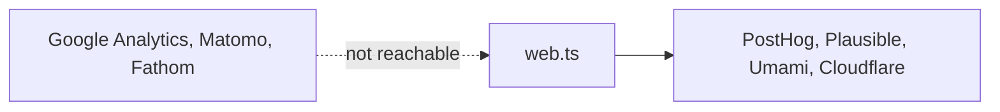
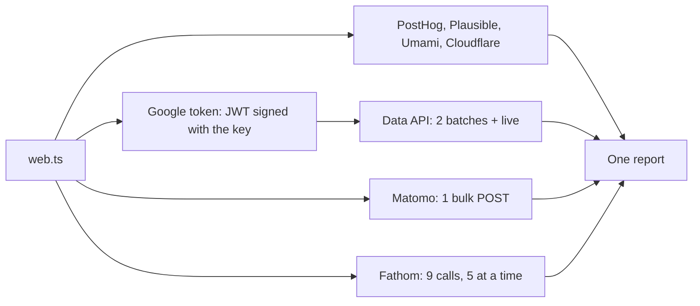

# Google Analytics, Matomo and Fathom on the Apps page

> **In plain words.** The second part of the owner's ask of 26 November ("all best ones we can
> add with all possible features"), after
> [PostHog, Plausible, Umami and Cloudflare](2026-11-26-website-analytics-apps.md). Three more
> apps can be connected under Apps, Analytics: Google Analytics 4, the one most websites use;
> Matomo, Cloud or a company's own server; and Fathom. Each gives the same report as the first
> four: visitors, visits, page views, the share that left, the average visit, the week before,
> each day, top pages, sources, countries, devices, browsers, events and who is on the site now,
> leaving out only what the app does not count. The report reaches the connection's page and the
> Reports page's Website part as before.

## What changed

| Part | Before | Now |
|---|---|---|
| Analytics apps | four | seven: `google-analytics`, `matomo` and `fathom` definitions, steps checked against each app's documentation on 2026-11-26 |
| Google Analytics | could not be read | the service account's JSON key is sealed like any key; each read signs a one-hour request with it in the Worker (WebCrypto, RS256), Google answers a token for `analytics.readonly`, then two batches of reports and the live count |
| Matomo | could not be read | one POST carries all 13 reports, the token in its body, never in an address; a part of Matomo switched off (Events, Live) leaves only its own figure out |
| Fathom | could not be read | nine calls, never more than five at once (the most a Fathom account may run) |
| A refusal | one sentence for every app | Google and Matomo say what to fix on their side: the Viewer access and the Data API, or the token's view access |

No table, migration, binding, secret, variable or dependency.

## Impact on each part

- **providers:** three definitions; Google's and Matomo's say auth `none`, as the reader sends
  their token itself.
- **connect:** three readers, three logos and colours, a line on each card; the call to an app
  can send another token or none.
- **analytics, template:** nothing: the Reports page reads the new apps through `connect.web`.

## How it worked before

## How it works now

## How it was verified

- `modules/connect/test/analytics.test.ts`: Google's token request checked against the public
  half of a key made in the test, its events of its own left out, a key that is not the file and
  one Google refuses each leading to the connection; Matomo's one request with no token in the
  address, a switched-off part left out, a refused token; Fathom never past five calls at once.
- `modules/providers/test/definitions.test.ts`: the seven definitions pass the contract; Matomo's
  address takes a folder but no other host, Google's property refuses a measurement ID.
- `pnpm verify`, quoted in the commit.
- Not checked: a live Google Analytics, Matomo or Fathom account (none is connected to this
  project); phone tests P930 to P932 are owed (first numbered P917 to P919,
  which the Data list took at the same time).
