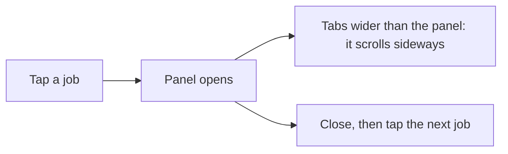
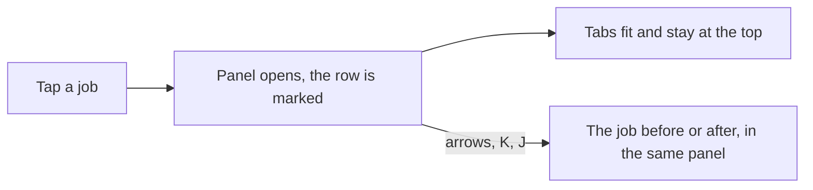

# The jobs panel polished: no sideways scroll, previous and next, sticky tabs

> **In plain words.** The owner found that the panel a job opens in could be scrolled left and
> right, which it never should, and asked for more of what such panels usually offer. It no
> longer moves sideways, its tabs stay at its top, the job open in it is marked in the list, and
> two arrows under its name (or the keys K and J, as in a mail app) open the job before or after
> it without closing the panel.

## What changed

- **No sideways scroll.** The panel sits inside the page, so it took the page's side gutter,
  wider than its own; the row of tabs reached past its edges by that difference. The panel now
  has its own gutter and clips anything wider than itself.
- **Previous and next.** Two arrows under the job's name, and K and J, open the job before or
  after it in the list it was opened from.
- **The open job is marked** in the list with a tint and a bar at the row's start, and the mark
  leaves when the panel closes.
- **The tabs stay at the top** of the panel while it scrolls.
- **Open as a page** is a button with its icon, and an empty panel shows a soft placeholder while
  the job loads.

## How it worked before and how it works now

## Impact

| Part | Effect |
|---|---|
| `@oltrem/screens` frame script | previous and next, the mark on the open row |
| `@oltrem/core-ui` stylesheet | the panel's gutter, sticky tabs, the mark, the placeholder; under its cap |
| `@oltrem/jobs` | the arrows and Open as a page in the panel's head |

## How it was verified

- The frame test: Next opens the row after the open one and moves the mark to it.
- The local portal in a headless browser at 390 px and 1440 px, light and dark: on every tab the
  panel's body is no wider than the panel, J and the arrow open the next job, the mark leaves on
  close, no script errors.
- `pnpm verify` before the push; phone test P966 in
  [phone-tests-system.md](../../docs/phone-tests-system.md).
