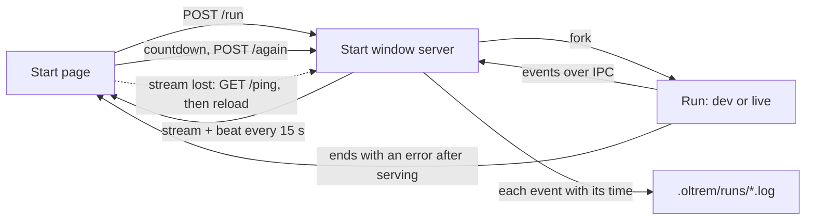

# The start page remade: run, retry, reconnect, log

> **In plain words.** The owner asked for a start page that is easier, smarter and sturdier. It now
> opens on **Run the portal**: two big choices, Local and Production, then Start. A portal that
> stops by itself starts again, a page that loses the start window finds it again and reloads,
> every run writes each line with its time to a file, and Production's "Which portal?" is asked on
> the page, where it used to end the run (exit 13).

## What changed

| Before | Now |
|---|---|
| An Overview of tiles first, then This computer, then Try it here | **Run the portal** first, with the checks' warning on top and **See what to fix** |
| Which data and Who may open it as two blocks of cards | **Local** (own data) and **Production** (live data) as two big choices; Who may open it as a sideways row; the last choice kept in the browser |
| While running: a line with Open and Stop | One panel: the address, how long it has run, what it says now, **Open the portal**, **Copy**, **Stop**, **Answer it** when a question waits |
| A portal that crashed stayed stopped | It starts again after 5, 10 and 20 seconds (not after Stop), with **Start it now** and **Do not start it** |
| A dropped stream said "The start window was closed" at once | The page looks for the window for about a minute (`/ping`) and reloads; the window waits 20 minutes, not 90 seconds; a line every 15 seconds keeps the stream open |
| One event the page could not draw ended the stream (read as "closed") | It is skipped and said in the browser's console |
| Logs: the tool logs and a report when it stopped | Also every event of every run with its time in `.oltrem/runs/`, the newest 20 kept, named on the page with **Copy**; the tool output has a filter and **Copy** |
| "Which portal?" from the page asked the closed terminal (exit 13) | Asked on the page (`runAsker`) |

## How it works

Before, a run's events reached the page and the terminal only, and a lost stream or one bad event
ended the page. Now each event also goes to the run's own file, the page restarts a crashed
portal through the same **Try again** route, and a lost stream is a reconnect, not an end.

## Verified

- `packages/cli/test/setup-page.test.ts`: run logs (name, pruning to 20, keys hidden, a folder
  that cannot be made), a run named and written through the server with `/again` and `/ping`,
  the page's words for time and its waits, the reconnect (reloads when back, says closed after
  its last look), an event that throws skipped without ending the stream.
- `packages/cli/test/live.test.ts`: "Which portal?" goes to the page when started from it.
- A headless render at phone and desktop sizes with a scripted run: start, serving, a crash, the
  countdown and the new start, with no page errors (it found the countdown's missing constant,
  fixed before the push).
- Not yet: a run on the owner's Windows PC.
