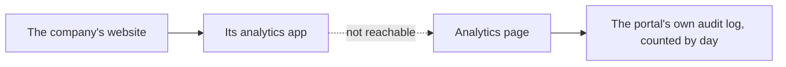
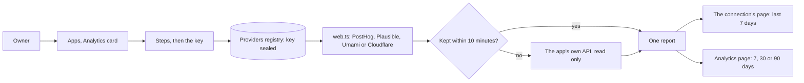

# Website analytics apps on the Apps page

> **In plain words.** The owner asked (26 November): "we dont use PostHog by default so it
> depends what is added in integration ... give it to Integration system for PostHog and other
> possible additions, integrations and all best ones we can add with all possible features". A
> company can now connect the app it already counts its website's visitors with, on the Apps
> page under a new Analytics filter: PostHog, Plausible, Umami (Cloud or its own server) or
> Cloudflare Web Analytics. It follows the app's own steps, pastes a read-only key, and the
> portal checks it at once. The connection's page shows the last 7 days: visitors, visits, page
> views, the share that left after one page, the average visit, the change on the week before,
> page views each day, the top pages, sources and countries, and who is on the site now. The
> same report, for 7, 30 or 90 days, is handed to the Analytics page.

## What changed

| Part | Before | Now |
|---|---|---|
| Analytics apps the portal knows | none: the Analytics page counted the portal's own audit log only | four definitions of the kind `analytics` in the providers registry, each with its key recipe and steps checked against the app's documentation on 2026-11-26 |
| Where one is connected | nowhere | Apps, Analytics: a card each, `/connect/analytics/new/<app>`, then the connection's page `/connect/analytics/<id>` |
| Who may | nobody | `connect.analytics.manage` (admin, at the company); without it the cards are greyed with "Ask an Owner" |
| Reading the website's figures | nothing | `src/web.ts`: one report shape for every app, a refusal in plain words with its fix, kept ten minutes in the Cache API; `connect.web(env, tenantId, days)` for the Analytics page |
| The email providers' pages | listed every kind but data and storage | an analytics app is neither listed nor counted there, like a database or a bucket |
| A definition's address | a data definition's host needed a pattern | an analytics definition's too |

No table, migration, binding, secret, variable or dependency: the key is a providers instance in
the existing table, sealed by the existing KEK, and a report is kept in the Cache API, never KV.

## Impact on each part

- **providers:** the four definitions, the `analytics` kind kept off its own routes and Home card,
  the pattern rule widened.
- **connect:** the capability, seven routes, the reader, the filter, the cards, two pages, the
  rows under Connected, the logos.
- **screens:** the generic "Add a provider" tiles leave the analytics apps out.
- **template:** hands `registry: providers.registry` to Connect.
- **analytics:** the Reports page's Website part reads `connect.web`, handed in by the client
  template as its `web` option.

## How it worked before

## How it works now

A key goes only to an address built from fields its pattern pins to the app's own shape
(`us.posthog.com` or `eu.posthog.com`, a host name, a 32-letter site tag, a website UUID), so a
changed field cannot send it elsewhere. Each app is asked in as few calls as it allows: PostHog
one HogQL query, Cloudflare two GraphQL calls, Umami nine, Plausible ten (its limit is 600 an
hour; with the ten-minute cache a busy page costs at most 60 an hour per window).

## How it was verified

- PostHog's query was run on a live project on 2026-11-26 and answered every row (totals, the
  week before, each day, the share that left and the average visit from its sessions, top pages,
  events, people now); Cloudflare's GraphQL query was run on a live account over 90 days earlier
  the same day. Plausible's and Umami's calls follow their documentation of that day.
- `modules/connect/test/analytics.test.ts`: each app's answer read into the report, Umami's two
  shapes, Cloudflare's missing week before, refusals and their fix, the cache; the routes through
  the pipeline with a real registry: connecting, refusing a duplicate and an address of another
  shape, no key shown back, a new key, a check pressed twice, `web`, removing.
- `modules/connect/test/pages.test.ts`: the cards, locked and absent, both pages and their posts.
- `modules/providers/test/definitions.test.ts`: the four definitions pass the contract, their
  patterns accept the app's own addresses and refuse others, and an address without a pattern is
  refused.
- `pnpm verify`, quoted in the commit.
- Not checked: the live portal with a real Plausible, Umami or Cloudflare key; phone tests P910
  to P916 are owed.
