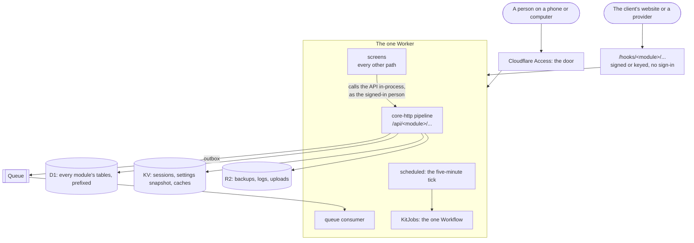

# Architecture guide

> **In plain words.** Read this after [ai.md](../ai.md) when you are new to the repository, person
> or agent. It shows the parts of the kit on one page, how a request and a background job travel
> through them, what a module is made of, which numbers are taken, and which file to open for a
> given task. The details live in each package's README; this page links to them instead of
> repeating them.

## The repository on one page

| Folder | What lives there | Depends on |
|---|---|---|
| `packages/core-*` | the runtime every client gets: errors, the module contract, the request pipeline, settings, outbox, audit, jobs, health, encryption, the design kit | core packages only |
| `packages/screens` | the portal's pages, rendered on the server with Preact inside the client's Worker | core packages and the modules whose API it reads |
| `packages/cli` | the `oltrem` command: manifest check, migrations, setup, deploy, docs, doctor, upgrade | core packages |
| `modules/*` | one feature each, as a package: `iam`, `users`, `records`, `forms`, `providers`, `email`, `backup`, `github`, `alerts` | core packages, the `iam` module (and `email` on `providers`) |
| `templates/client` | what a client repository is: one Worker that mounts the modules, its manifest, migrations, workflow | core packages and modules |
| `templates/module` | the module `oltrem new module` copies into a client repository | core packages |
| `scripts/` | the verify chain and its gates, the install and dev runners | Node only |
| `docs/` | this folder: the index, status, roadmap, records, generated references | nothing |

`eslint.config.js` enforces the "depends on" column (plan 15.6): a module importing another
module it may not stand on fails `pnpm lint`.

## One client at run time

Each client has its own Cloudflare account and one Worker with one of each resource (R-09):

- **Pages never touch the database.** A screen calls the same `/api` routes a script would, inside
  the same request, so the permission check, the schema and the audit apply to it unchanged
  (`packages/screens/src/api.ts`).
- **Nothing is shared between clients.** A client's data, keys and deploys stay in its own account.

## How a request travels

```mermaid
flowchart LR
  r[Request] --> id[request id,<br/>security headers]
  id --> csrf[same-origin check<br/>on /api]
  csrf --> who[identity:<br/>Access token or the local door]
  who --> start[startup, once per isolate:<br/>capabilities registered]
  start --> sess[session hook:<br/>the compiled permission map]
  sess --> can[authorize:<br/>the route's capability]
  can --> schema[schema:<br/>body or query]
  schema --> h[handler]
  h --> audit[audit row,<br/>after the response]
```

The order is in `packages/core-http/src/app.ts`. Every failure on the way becomes one problem
document with a `KIT-E-` code, a plain sentence and what to do (`@oltrem/core-errors`).

## How background work travels

| Kind | Declared on the manifest as | Runs | Owned by |
|---|---|---|---|
| A job | `jobs: [{ id, every, run }]` | on the tick when due, under a lease, its outcome recorded | `@oltrem/core-jobs` |
| A flow | `flows: [{ id, schedule?, run }]` | in the one Workflow, step by step, each step retried | `@oltrem/core-jobs` |
| A health check | `health: [{ id, lane, run }]` | as a job; two failures in a row open a problem and an alert | `@oltrem/core-health` |
| An event | `eventTypes` and `onEvent` | from the queue, after the outbox wrote it | `@oltrem/core-outbox` |
| A public hook | `hooks: [{ path, handler }]` | on a POST from outside, before the door; the handler verifies the caller | `@oltrem/core-http` |

The free plan's limits shape all of it: about ten milliseconds of CPU per request, so heavy work
is a flow, and the budgets on System health pause the jobs before a daily allowance runs out.

## What a module is

A module is a package that exports one manifest, built with `defineModule` from
`@oltrem/core-module`. The contract validates it when it is defined, so a bad manifest fails the
build and never a deploy. Its fields:

| Field | Says | Read by |
|---|---|---|
| `id`, `version` | who it is; the version moves with its capabilities | everything; the capability version gate |
| `bitPlane`, `capabilities` | what its routes check, on its own plane of the permission map | `iam` at startup, the screens' role editor |
| `api` | its routes under `/api/<id>/`, each with a capability and a schema | the pipeline, the generated reference |
| `hooks` | its public addresses under `/hooks/<id>/` | the pipeline |
| `jobs`, `flows`, `health`, `eventTypes` | its background work, above | the scheduler, the Workflow, the health runner, the queue |
| `migrations` | its SQL files, numbered in the kit's one series | `oltrem migrations sync` and `apply` |
| `settings`, `errors`, `secrets` | its typed settings, its error codes, its key recipes | the Settings page, the error reference, `oltrem doctor` |
| `home` | its card on Home | the screens |
| `pages` | its own screens and sidebar sections, joined from a separate JSX entry with `withPages` | the screens |

A module's README is the authority on it: its routes, tables, settings and errors. The
[index](README.md) links every one.

## Numbers that are taken

Each of these is claimed once and kept for ever. Take the next free one and claim it in the
owning README in the same commit.

| Series | Taken | Next free | Claimed in |
|---|---|---|---|
| Migrations (kit) | `0001` to `0026`, one series for the whole kit; client numbers start at `5000` | `0027` | the owning package's `migrations/` and its README |
| Permission bit planes | `0` iam, `1` users, `2` providers, `3` email, `4` backup, `5` github, `6` health, `7` settings, `8` alerts, `9` audit, `10` records, `11` forms, `12` files, `13` campaigns, `14` developer, `15` automations, `16` analytics, `17` privacy, `18` tasks; a client's own modules take theirs from `100` | `19` | the module's capability declaration |
| Error codes | `0400`s and `1000`s core, `1100` audit, `1200` outbox, `1300` crypto, `1400` providers, `1500` email, `1600` backup, `2000` iam, `2100` users, `2200` records, `2300` forms, `2400` files, `2500` campaigns, `2600` developer, `2700` automations, `2800` privacy, `2900` tasks | the `3000` block | the module's `errors.ts` and README |

## Where a change goes

| You want to | Open |
|---|---|
| Add a feature for every client | a new folder under `modules/`, copied from the shape of a small module such as `modules/github`; mount it in `templates/client/src/index.ts` |
| Add a feature for one client | `oltrem new module <name>` in that client's repository (`templates/module` is what it copies) |
| Change who may do what | the module's capability list; the model is in [the IAM README](../modules/iam/README.md) |
| Add or change a page | a module's own page: its `src/pages.tsx`, joined with `withPages` ([core-module](../packages/core-module/README.md)); a kit page: `packages/screens/src/`, the frame and its sidebar are `layout.tsx` |
| Change the look | the tokens in `packages/core-ui/src/theme.css`, then `pnpm ui:build` |
| Add a setting | `defineSetting` in the module, listed on its manifest; never an environment variable (R-09) |
| Store a credential | a provider definition and instance (`modules/providers`), sealed by `@oltrem/core-crypto`; a Worker secret only with a key recipe and a token registry row (R-05) |
| Add a periodic task | a job on the manifest; a long one a flow |
| Add a gate | `scripts/lib/gates.mjs`, a test beside it, then `pnpm docs:build` |

## The rules that shape every change

- `pnpm verify` is the only gate before `main`, and a push to `main` is the release (R-01, R-02).
- Every file is written as if public: no identifiers, no hostnames, no personal data (R-04).
- Settings are data, resources are one of each, a new dependency needs a reason in the registry
  (R-09). The kit never adds a binding for a feature: a module uses the client's one database,
  one namespace, one bucket and one queue, under its own prefixes.
- Real data only: a screen shows what the API returns or says plainly that nothing is there (R-10).
- A change is not done until the document that owns the fact says so, in the same commit (R-07).

## Tests

Worker code is tested inside the Workers runtime against local D1, KV and R2 with the migrations
applied (`@cloudflare/vitest-plugin`); the tool and the scripts on Node. The client template's
`test/` runs whole journeys through the real pipeline: sign-in, first run, permissions, providers,
alerts. Rows written in one test stay for the next in the same file, so each test makes its own.
