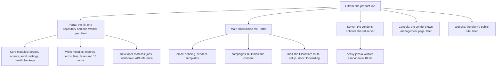
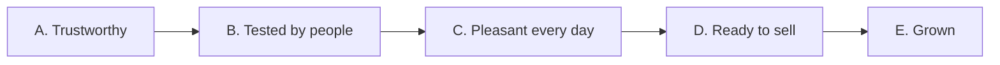

# Oltrem products: the plan by level and by phase

> **In plain words.** Oltrem is one family of products. This page puts all of them on one map,
> in three levels: the **product line** (Oltrem), the **products** a client can have (the
> Portal, Mail, the Server, and later the vendor's Console and the Website), and the
> **modules** inside each product. It then sets the order of work in five phases, each with what
> "done" means, so the work goes from "built" to "trusted", then to "tested by real people",
> then to "sold". Nothing here changes a decision the owner has made; the decisions still open
> are listed at the end in plain words. The detailed plans stay where they are and are linked.

## Contents

1. [The three levels](#1-the-three-levels)
2. [Level 2: the products](#2-level-2-the-products)
3. [Level 3: the modules of each product](#3-level-3-the-modules-of-each-product)
4. [The five phases](#4-the-five-phases)
5. [Each product, phase by phase](#5-each-product-phase-by-phase)
6. [Rules every phase keeps](#6-rules-every-phase-keeps)
7. [The owner's open decisions](#7-the-owners-open-decisions)

## 1. The three levels

| Level | What it is | Where it is decided |
|---|---|---|
| 1. Product line | **Oltrem**: ready-made business portals any company can use, each running in the client's own Cloudflare account on the free plan, private while the owner tests it | the plan on the docs mirror, linked from [the index](README.md) |
| 2. Products | the things a client has or the vendor runs: Portal, Mail, Server, Console, Website | this page |
| 3. Modules | the parts inside a product, each one package that is switched on or off per client | [the roadmap](roadmap.md) for the Portal, oltrem-mail's plan for Mail |

## 2. Level 2: the products

| Product | What a client gets | Repository | State on 2026-11-03 |
|---|---|---|---|
| **Portal** | the admin portal itself: people and access, audit, backups, health, and the everyday work modules, on a phone first | this repository (the kit), packed into one private repository per client | phases 0 to 6 built; every phase's acceptance waits on a sandbox client ([where things stand](status.md)) |
| **Mail** | email that sets itself up: sending through Cloudflare or a provider, bulk mail with consent, an inbox, forwarding | oltrem-mail, packed into this repository's `vendor/mail/` | plan phases 1 to 5 built 2026-11-02, plus the inbox and forwarding bundles; phone tests owed ([the packed copy](../vendor/mail/README.md)) |
| **Server** | an optional paid extra: the vendor's own server lends each portal a fixed allowance for heavy jobs (whole emails, search, PDFs, virus checks) | not started; designed in [the shared server](reference/shared-server.md) | design only; waits on the owner's six answers |
| **Console** | for the vendor only: every client portal at a glance (version, health, last backup, last deploy) | none yet | not now: the owner will build it later (decided 2026-11-01); the Portal only keeps what it would read ready |
| **Website** | the client's public site on the same account: pages, content, SEO, visitor counts | none yet | later, as the plan's section 4.4 lists it |

A client's portal is always **one Worker**: Mail adds tables to its one database and files to its
one bucket, never a second Worker (decided 2026-11-02). The Server is never required: a portal
without it works exactly as it does on Cloudflare alone.

## 3. Level 3: the modules of each product

### Portal

| Group | Modules | State |
|---|---|---|
| Core, in every portal | `iam`, `users`, `privacy`, settings, audit, `alerts`, health, `backup`, `github` | built |
| Work | `records`, `forms`, `files`, `tasks`, `approvals`, `announcements`, `bookings`, `timeoff`, `expenses`, `assets`, `timeclock`, `shifts`, `quotes`, `invoices`, `customers`, `automations`, `analytics` | built 2026-10-22 to 10-27 |
| Messages | `providers`, then Mail's three modules | built |
| Developer | `developer` (jobs page, webhooks, API reference) | built; API keys later |
| Everyday polish, across every module | saved views, bulk actions, a get-started checklist, undo, a notifications inbox (the top of [the open-source ideas](reference/open-source-ideas.md)) | proposed, waiting for the owner's pick |
| Kit health, under every module | an error log, performance budgets, a phone and accessibility check (the top of [the kit review](reference/kit-review.md)) | proposed 2026-11-03; the error log done the same day |

### Mail

| Module | What it does | State |
|---|---|---|
| `@oltrem/email` | sending through the active route, senders and domains, templates, Write and Sent | built |
| `@oltrem/campaigns` | bulk mail, lists, three scopes for leaving, warm-up of a new domain | built |
| `@oltrem/mail` | the Cloudflare route, the Mail setup page, the inbox, forwarding | built; off by default per client |
| Reading heavy mail through the Server | whole emails and attachments over 10 ms of work | waits on the Server |

### Server

| Part | What it does | State |
|---|---|---|
| Keys and allowances | one key per client portal, a fixed allowance per key | designed |
| The job runner | fetch, work, answer, delete; no client data kept | designed |
| The vendor's page | keys, allowances, usage | designed |
| Installed the same way on any cloud | one script, no lock-in | designed |

### Console and Website

Not split into modules yet: each gets its own section here when the owner starts it.

## 4. The five phases

The phases run across all products. A phase ends when its "done when" line is true, checked and
written in a record; the next phase may start before, but nothing is called finished early.

| Phase | Name | What it is for | Done when |
|---|---|---|---|
| **A** | Trustworthy | what is built works, is watched and is proven: no error goes unseen, the free plan's limits are measured and kept, docs say what is true | every server error is kept and shown in the portal (done 2026-11-03); a client Worker's size and its CPU per page have a budget the verify chain enforces; a sandbox client deploys with one command and its doctor is green |
| **B** | Tested by people | the owner, then friends, then a first client use a real portal for their real work | the owed phone tests pass; an upgrade from one kit version to the next is done twice without help; a restore drill passes on the live sandbox; Mail runs on a real domain for a month |
| **C** | Pleasant every day | the small things people notice: saved views, doing many at once, undo, a first-day checklist, one place for notices | the owner's chosen items from [the open-source ideas](reference/open-source-ideas.md) are built and tested on a phone |
| **D** | Ready to sell | what a buyer needs before paying | the licence has its legal name and a lawyer's read; the editions and prices are written; a demo portal with sample-free real setup exists; the Server's first version runs for one client, if the owner approves it |
| **E** | Grown | the vendor side and the later products | the Console, the Website, more languages (Spanish first), SMS and WhatsApp, each when the owner starts it |

## 5. Each product, phase by phase

### Portal

| Phase | Work | Who |
|---|---|---|
| A | **A1** error log: every server error kept in the database, grouped, listed on the Alerts page and emailed once ([kit review K1](reference/kit-review.md)) | **done** 2026-11-03 |
| A | **A2** performance budgets: the Worker's size held by the verify chain (**done** 2026-11-03), CPU per page measured in tests; then the cold start made cheaper (K2) | agent |
| A | **A3** the sandbox: a fresh Cloudflare account and a private client repository, made with `oltrem new client` and `npm run deploy` (K3) | owner, about 15 minutes, then agent |
| A | **A4** a phone and accessibility check on every page's HTML in the verify chain (K5) | **done** 2026-11-03 for names, labels and the viewport; sizes and widths wait on a browser in verify |
| A | **A5** documents brought up to date: where things stand and the roadmap (K4) | agent |
| A | **A6** extras a portal can do without (the daily audit seal, the reminders) switched off on the Modules page (the owner's ask) | **done** 2026-11-03 |
| B | the owed phone tests, collected on [one list](phone-tests.md) (**done** 2026-11-03); the upgrade path twice; a live restore drill | owner on a phone, agent the rest |
| C | the owner's pick of R1 to R15; first suggestion: R3 get-started checklist (**done** 2026-11-03), R1 saved views (**done** 2026-11-03), R2 bulk actions (**done** 2026-11-03), R6 notifications inbox (**done** 2026-11-03) | agent |
| D | editions turned on and off from the client file; a demo portal; the buyer's guide | agent, owner for prices |
| E | Spanish, API keys, website forms in more languages, SMS and WhatsApp | later |

### Mail

| Phase | Work | Who |
|---|---|---|
| A | its server errors go to the same error log once A1 ships (no change in oltrem-mail needed: it reports through the kit) | agent |
| B | the bundle phone tests owed (A, B, C, F, L); one real domain on the Cloudflare route for a month; the ImprovMX key card | owner |
| C | Gmail-like touches the owner asks for after the tests | Mail thread |
| D | the placement test and the SPF count shown to a buyer as "your mail is set up right" | Mail thread |
| E | reading whole emails through the Server | after the Server |

### Server

| Phase | Work | Who |
|---|---|---|
| A, B | nothing to build: the owner answers the six questions in [the design](reference/shared-server.md) when ready | owner |
| D | version 1 for one client: a key, an allowance, Mail's heavy reads | agent, after the owner's yes |
| E | other modules' heavy jobs (PDFs, search, virus checks) | agent |

### Console

| Phase | Work |
|---|---|
| A to D | none built. The Portal keeps the facts a Console would read in one place: the kit version, the last deploy, health and the last backup (the `github`, health and `backup` modules already hold them) |
| E | the owner builds it, if and when the owner decides |

### Website

| Phase | Work |
|---|---|
| E | `site`, `cms`, `seo` and visitor counts, as the plan's section 4.4 lists them, inside the same one Worker |

## 6. Rules every phase keeps

- **Private.** No public organisation, package or registry until the owner has tested it first,
  with friends and with some clients, and calls it finished (decided 2026-11-01).
- **For any business.** Every feature is one most companies use; nothing is aimed at one trade.
- **The free plan.** Under 10 ms of CPU per request, no per-change KV writes (1,000 a day), the
  database for counters and logs; [the budgets](../packages/core-health/README.md) are watched on
  System status.
- **Least manual work.** One command or one press does the whole job; every failure says its fix
  in words and lands where the portal's logs and alerts see it.
- **One of each resource.** One Worker, one database, one bucket per client (R-09).
- **Phone first.** The sidebar is the only menu on a phone; a page's options sit in a sideways row.

## 7. The owner's open decisions

In plain words, each with what happens while it waits:

| Question | Why it matters | Until then |
|---|---|---|
| Will you make the sandbox: a fresh Cloudflare account and one private repository? | every phase's "done" needs one real portal that is not yours | phase A stops at A3; the rest goes on |
| Which of the everyday ideas R1 to R15 first? | phase C builds exactly those | the suggestion in section 5 stands |
| The shared server's six questions | it is the only paid extra | nothing of the Server is built |
| The licence's legal name and contact address, and a lawyer's read | a buyer signs it | the licence stays as written |
| Prices per edition | phase D | none written |
