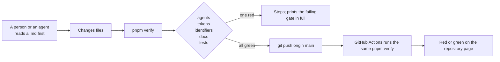

# Phase 0: the repository basics

> **In plain words.** On 2026-10-19 the owner made the kit's first repository and asked for
> the basics to start there, with the documentation in its own folder so he can follow along.
> This first commit puts in place the contract every AI agent reads first, the rules in full,
> the token registry that stops credentials from multiplying, and the one command that checks
> everything before a push. Nothing is deployed, and no account, token or resource exists yet.

## What changed, and why

| What | Why |
|---|---|
| **ai.md**, the one file every tool and person reads first, and **rules.md** with every rule in full | The owner's instruction: one entry file like the first client's contract, and a rules file behind it. Each rule names what enforces it, or says that nothing does yet |
| **AGENTS.md** and **CLAUDE.md**, generated pointers | Every coding tool reads a different file name; the pointers send them all to ai.md and are checked byte for byte so they cannot drift |
| **tokens.registry.json** and the generated **token registry page** | The owner's instruction: creating or adding a credential needs its documentation, so an existing one is reused instead of a new one made. Nine names from the plan are registered as planned; none is created |
| **`pnpm verify`** with five gates: agents, tokens, identifiers, docs, tests | The plan's one-command gate. Each gate is a small script with no dependencies, and a test suite on Node's built-in runner proves each refusal |
| **The identifier scan** | The plan's phase 0 asks for a scan that catches a name of the first client's platform, so "design, not code" is checked and not hoped for; it also catches identifier shapes and email addresses |
| **The verify workflow** on GitHub Actions | The same command runs on every push to `main`, in well under a minute, because the repository has no dependencies |
| **docs/** with an index, this record and two generated references | The owner asked for a separate folder he can watch; every document is indexed and carries front matter, and the generated ones are compared with their source on every run |
| **LICENSE** (Apache License 2.0), `package.json`, `pnpm-workspace.yaml`, `.gitignore` | The licence the owner chose; the workspace shape the plan describes, declared before any package exists |

## Decisions taken while building

- **The registry is JSON, not TypeScript, for now.** The plan names a TypeScript registry file. This repository has no TypeScript toolchain yet (phase 1), and a typed file nothing type-checks would be a false promise. The JSON file is validated field by field by the tokens gate; it becomes a typed file when the toolchain arrives, with the same fields.
- **The repository lives under a personal GitHub account.** The plan expects an organisation named after the kit, which the package scope needs. Nothing is published before phase 6, so this does not block anything yet; the organisation should exist before the first package is published.
- **This repository is treated as the kit itself**, the monorepo of the plan, not as a client repository. The client template and the sandbox client are separate repositories, still to be created.
- **Generated documents are compared, not trusted.** `pnpm docs:check` regenerates every generated document in memory and fails on a difference, so a hand edit is caught at once.
- **Tests build their fixtures from a copy of the repository.** Each refusal test copies the repository to a temporary folder, breaks one thing, and asserts that the right gate refuses it, so the gates are tested against the real files.

## Impact on each service

None. Nothing is deployed, no account exists, and the first client's platform is not touched.

## Before and after

Before this commit the repository was empty: a default branch with no files.

The gates run in order and the first failure stops the run. The same command runs again on
GitHub after the push; nothing deploys from this repository, so the workflow is a visible
record, not a release.

## How it was verified

- `pnpm verify` passed locally on this commit: five gates, with the summary line quoted in the
  commit message.
- The test suite exercises each refusal on a copy of the repository: a pointer file that
  differs, a rule line with no rule, ai.md over budget, a secret name without a row, a row with
  a missing field, a denied name, a UUID shape, a hand-edited generated document, an unindexed
  document, and generation that is not deterministic.
- The identifier scan was run against this repository with the plan's public link as the one
  allowed string.

## What is left in phase 0

The client template and sandbox repositories, the fresh Cloudflare account for the sandbox
(the owner's step), the CPU measurement of three sample screens, and the first week's open
questions named in the plan. The index page carries the live state.
