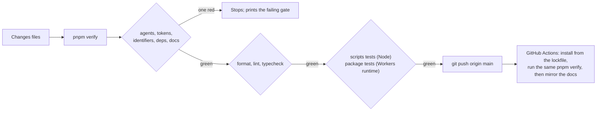

# Phase 1: the toolchain and the configuration layers

> **In plain words.** On 2026-10-19 the owner said to continue, so the kit's code began. This
> commit adds the tools every package will be built and checked with (types, tests that run
> inside Cloudflare's own runtime, a linter that knows which part may import which, a formatter,
> and a register of every outside package with the reason it exists), and the first core
> package: the configuration layers. That package is how a client's settings reach a running
> Worker fast, how an admin changes one live, and how a kit default, a client file and a live
> setting are kept apart. Nothing is deployed; the package runs only in the tests so far.

## What changed, and why

| What | Why |
|---|---|
| **TypeScript** with the strictest useful settings, one `tsconfig.json` for every package and module | The plan asks for a typed kit an agent can refactor safely; `pnpm typecheck` is the gate |
| **Vitest with Cloudflare's Vitest plugin**: package tests run inside the Workers runtime, with the bindings each package's `wrangler.jsonc` declares and its own migrations applied first | Code that passes in Node and fails in a Worker is caught before a deploy; the configuration package's D1 and KV behaviour is tested against the real APIs, in memory |
| **ESLint with the boundaries plugin**: a core package imports only core; a module imports core and never another module; the client template imports core and modules | The rule file doubles as the architecture diagram; a wrong import fails `pnpm lint` |
| **Prettier**, with Markdown left alone | One formatting, so agents never argue about style and a diff shows only meaning |
| **The dependency registry** (`dependencies.registry.json`, the catalog of `pnpm-workspace.yaml`, the `deps` gate, a generated page) | The owner's rule for tokens, applied to packages: each is pinned once, has a written reason, and a row nothing uses is refused |
| **`pnpm verify`** grows from five gates to ten: the quick ones first, then format, lint, typecheck, the scripts' tests and the Workers tests | The one command stays the one gate; the first failure still stops the run |
| **`@oltrem/core-config`**: `defineSetting` (one definition per setting: key, schema, default, layer, who edits it, when it takes effect), the four layers with precedence and locks, the snapshot, the D1 store with its history table, and the read path | The plan's section on configuration, built as written: a client's settings are data; a kit default, a client file and a live setting are kept apart; the hot path never leaves memory |
| **Migration `0001_settings.sql`**: `oltrem_meta`, `oltrem_settings`, `oltrem_settings_history`, in the ledger `oltrem_migrations` | The package owns its tables; additive and idempotent, as the plan requires of every migration |
| **The verify workflow** now installs dependencies from the lockfile before running the same command | The repository has dependencies now; the run stays short because every package is pinned and cached |

## Decisions taken while building

- **TypeScript stays on the 5.x line for now.** The next major version exists, but the linter's
  TypeScript support does not cover it yet. The pin is in the catalog with that reason; it moves
  when the linter does.
- **Cloudflare's test tooling was renamed while this was built.** The package the plan names was
  renamed to `@cloudflare/vitest-plugin` and will receive no further updates, so the kit uses the
  renamed one. Its API is a Vite plugin (`cloudflareTest`), not a pool option. The runtime binary it
  bundles decides the newest `compatibility_date` a test Worker may declare.
- **The test runtime shares storage within a test file.** The current plugin has no option to give
  each test its own storage, so the configuration tests reset their tables and the KV key before
  each test. This is explicit in the test file rather than hidden in a setting.
- **`wrangler` is not a dependency yet.** The Vitest plugin brings its own copy to read
  `wrangler.jsonc`, and nothing deploys from this repository. The deploy tool arrives with the
  client template, with its own row.
- **No task runner, hook tool, unused-code finder or bundle-size check yet.** The plan says pnpm
  alone is enough until `pnpm verify` is slow; it is well under the plan's threshold, and each of
  those tools would be a dependency without a present need (R-09).
- **The dependency registry is JSON**, like the token registry, validated field by field by its
  gate, and rendered to a page. Both become typed files together when a typed registry is worth
  the toolchain it needs.
- **Settings are validated with Zod Mini**, the small build, and every definition exports its JSON
  Schema, so the Settings page, the seed and the reference page can render from the same source
  without a second schema language.
- **A key is `module.name`**, and the module part must match the module that defines it; a
  `client`-layer key is locked, so a live value for it is ignored and reported rather than applied.
- **One KV key holds the whole snapshot**, with the configuration version in its metadata, so a
  Worker's cold start is one read and a request carrying a newer version can tell at once that it
  needs D1.

## Impact on each service

None. Nothing is deployed, no account exists, and the first client's platform is not touched.

## Before and after

Before this commit the repository held the contract, the registries and five gates that needed
no dependencies; there was no code to check.



The read path the package implements, per request in a Worker:

```mermaid
flowchart LR
  R["config.ensure(ctx.waitUntil)"] --> M{"snapshot in memory?"}
  M -- "fresh" --> V["config.get(key): no I/O"]
  M -- "stale" --> V
  M -- "stale" -.->|"after the response"| KV["KV: one snapshot key"]
  M -- "cold" --> KV
  KV -- "missing or unreadable" --> D1["D1: the settings tables"]
  D1 -- "rebuilt snapshot" --> KV
  D1 --> V
  KV --> V
  X["neither answers"] --> Z["kit and client defaults,<br/>one error event, retry later"]
```

A save is one D1 transaction (the row, its history row, the version bump), then the snapshot
rebuilt, one KV write, and the saving instance updated, so the admin who saved sees the value at
once. A request that carries a newer version than the instance holds reads D1 once and catches up.

## How it was verified

- `pnpm verify` passed locally with all ten gates; the summary line is quoted in the commit
  message.
- The package's tests run inside the Workers runtime: the precedence and the locks of the layers,
  the refusals of a bad definition or a bad save, the hot path with no I/O at all, the stale
  snapshot served and refreshed after the response with one KV read, the fallbacks when KV or D1
  fail with one error event each, and read-your-writes.
- The dependency gate's refusals are each tested on a copy of the repository: an unregistered
  dependency, a version written outside the catalog, a row nothing uses, a catalog entry nobody
  uses, a row with a missing field, and the catalog read with quoted and bare names.
- The identifier scan and the agents' copied-facts check pass on every new file.

## What is left in phase 1

The command-line tool (`setup`, `doctor`, `dev`, `manifest check`), the other core packages the
plan names, and the first deploy of the configuration package in the sandbox client, which waits
on the fresh Cloudflare account, the owner's step. The index page carries the live state.
