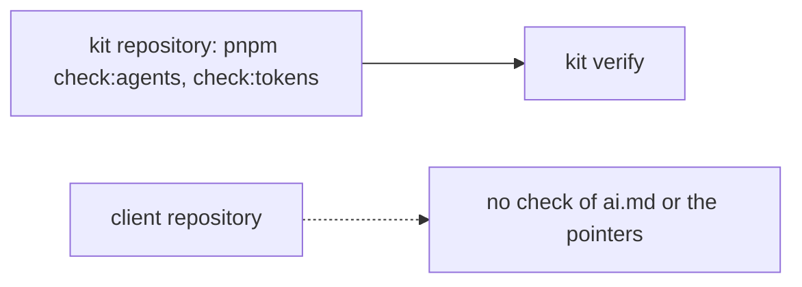
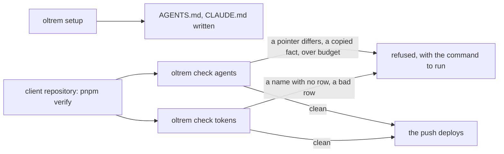

# Phase 1: the two check commands of a client repository

> **In plain words.** The kit repository has, since its first day, two small guards: one that
> keeps the instruction file every AI reads short, honest and pointed to by the right files, and
> one that keeps every credential listed by name in the token registry. A client repository
> needs the same two guards, run by the kit's tool rather than by scripts of its own. They now
> exist as `oltrem check agents` and `oltrem check tokens`, run on every verify of a client
> repository, and the doctor reports the first as a check of its own. With them, the tool's list
> for phase 1 in the plan is complete; what remains of the phase is the first real deploy, which
> waits on the sandbox repository and the fresh account.

## What changed, and why

| What | Why |
|---|---|
| **`oltrem check agents [dir]`**: ai.md under 8 KB, the pointer files `AGENTS.md` and `CLAUDE.md` as the tool writes them, the always-loaded files under 24 KB, no copied fact, and `rules.md` cross-checked when present | Plan 15.1 (R-08): one entry file every tool reads, pointers generated and never hand-written, numbers kept in the generated reference |
| **`oltrem check tokens [dir]`**: every registry row complete, every secret name in use with a row | Plan 9.4 (R-05): a credential exists by name only, reuse before create; the client's verify refuses a name with no row |
| **`setup` writes the pointer files**, and the doctor gains **`AGENTS-01`** | The pointers are generated files, so the setup command owns them; the doctor is the one list of what a repository needs |
| The registry rules moved to one file the docs, the doctor and the check share; `TOKEN-01` finds names the same way the check does | One definition of a valid row and of a name in use, so the three cannot disagree |
| The test fixture gained its own `ai.md` and pointers; the template's `AGENTS.md` is now the tool's text | So the fixture is a whole client repository, and the template passes its own verify |

## Decisions taken while building

- **A client repository without `rules.md` is allowed.** Its ai.md names the kit's rules, which
  live in the kit; the check says so in its note rather than failing. Once the plan's
  `oltrem init` copies rules.md into each client, the cross-check runs there too.
- **The pointer text names its writer** (`oltrem setup`), so a reader who finds it knows not to
  edit it and what regenerates it.
- **`setup` writes a pointer that differs**, as it writes the generated reference: both are
  generated files whose only correct content is the template's.
- **The kit repository keeps its script versions** of the same two gates for now: they run before
  the tool is built, and the kit's own pointers and token page differ from a client's. Folding
  them onto the tool is a later clean-up, noted in the index's log.

## Impact on each service

None. Nothing is deployed and the first client's platform is not touched.

## Before and after

Before this commit only the kit repository checked its instruction files and its registry; a
client repository had the doctor's `TOKEN-01` and nothing for its instruction files.

Now every client repository runs both checks on every verify, and `setup` writes the pointers.

## How it was verified

- `pnpm verify` green locally, its twelve gates; the tool's tests on Node cover both commands:
  the budgets, a pointer that differs or is missing and its rewrite, the rules cross-check both
  ways, a copied count and a hostname, the names found in the Worker's required secrets and the
  workflow, a `wrangler secret put` in a document, a bad or missing registry, `--json`, and the
  exit codes `0`, `1` and `3`; `AGENTS-01` passing, skipping and failing with its fix.
- Both commands run clean on the client template and the fixture, by hand and in the tests.
- Not verified: nothing has run in a real client repository; the first is the sandbox.
