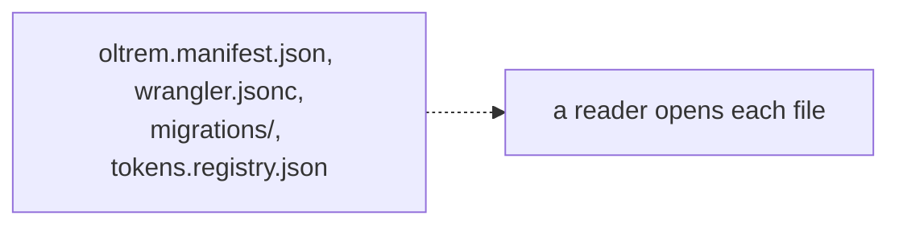
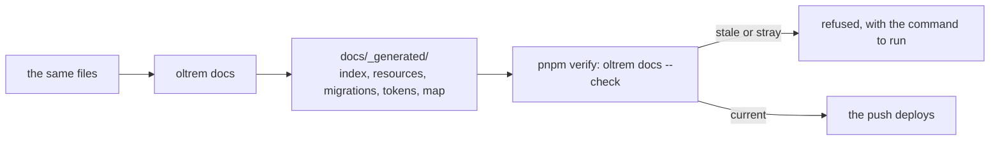

# Phase 1: the generated reference of a client repository

> **In plain words.** A client repository now writes its own reference pages: which resources
> its Worker has, which database migrations it carries, which credentials exist by name, and
> which files are where. Nobody types these pages. The tool `oltrem docs` reads the
> repository's own files and writes them, and every verify checks that the written pages still
> match the files. So the reference cannot go stale or drift from the truth, and an agent or a
> person opening the repository on a phone reads what the repository actually holds. This is
> the second to last item of the tool for phase 1; `oltrem dev` remains.

## What changed, and why

| What | Why |
|---|---|
| **`oltrem docs [dir] [--check]`** in `@oltrem/cli`: five pages in `docs/_generated/` (an index, resources, migrations, tokens, a repository map) | Plan 15.5: generated reference, never written by hand (R-06), so documentation and code cannot disagree |
| **`--check`** reports a stale page or a stray file and writes nothing; the client template's `verify` runs it | A client's push is its deploy, so the check runs in the one gate that runs before it |
| **The registry validated first**, by the kit's own rules | A credential's row is the only record of it (R-05); a bad row is refused with its number instead of rendered |
| **`DOCS-01`** in the doctor, and `setup` writes the pages | The doctor is the one list of what a repository needs; a new repository has its reference from its first command |
| The template's and the test fixture's registries rewritten in the kit's row shape, and their five pages committed | One row shape for every registry the kit touches; a test holds the template's pages to what the command renders |

## Decisions taken while building

- **The folder is the command's.** Any `.md` file in `docs/_generated/` that the command did not
  write is reported and, without `--check`, removed. Hand-written notes go elsewhere.
- **Checksums are written as `sha256-` with base64**, as the migration ledger already does, so
  the identifier scan of a kit repository never mistakes one for a key.
- **One small table per credential** rather than one wide table, because the pages are read on a
  phone; the kit's own token page made the same choice.
- **Only what exists today.** Routes, capabilities, settings keys, error codes and key recipes
  are named as coming once a client has modules; no empty page stands in for them (R-10).

## Impact on each service

None. Nothing is deployed and the first client's platform is not touched. The sandbox client
will be the first repository to carry these pages for real.

## Before and after

Before this commit a client repository's facts lived only in its configuration files, and a
reader had to open each one.

Now the tool writes the reference from those files, and verify refuses a stale copy.

## How it was verified

- `pnpm verify` green locally, its twelve gates; the tool's tests on Node cover the five pages
  rendered from the fixture, a stale page and a stray file in both modes, a bad registry row
  refused with its number, the exit codes `0`, `1` and `3`, `--json`, the doctor's `DOCS-01`
  passing and failing, and `setup` writing the pages.
- A test holds the client template's committed `docs/_generated/` to what the command renders
  from the template, so a change to the template without regenerating fails verify.
- Not verified: nothing has run in a real client repository; the first is the sandbox.
