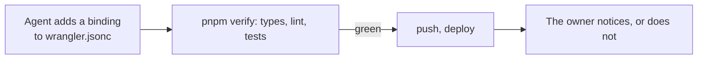
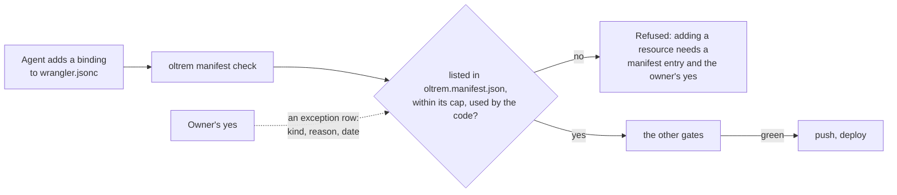
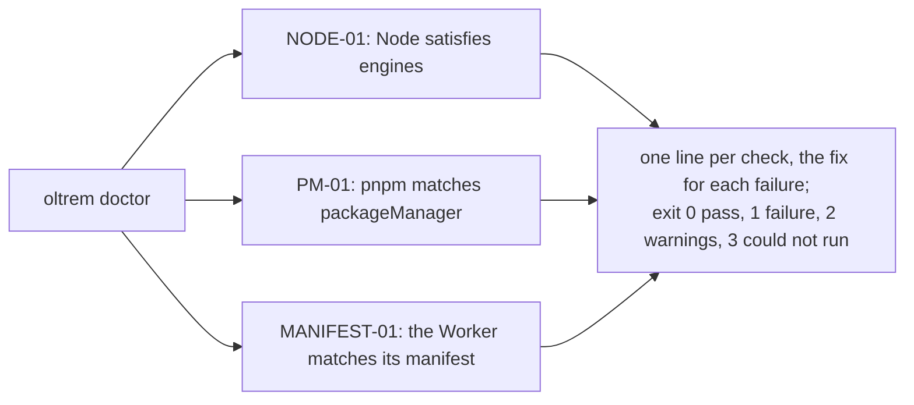

# Phase 1: the command-line tool, the manifest check and the doctor

> **In plain words.** On 2026-10-20 the owner said to start the next step, so the kit's
> command-line tool began. Its first command keeps the owner's "one of each" rule: a client's
> Worker may have one database, one bucket, one key-value namespace, one queue with its
> dead-letter queue, two coordination classes at most, one workflow, one cron, three variables
> and at most twelve secrets, and every one of them has to be written down in a manifest file.
> The check compares that file with the Worker's configuration and with the code, and refuses
> a change that adds a resource quietly. Its second command, the doctor, checks that a
> repository has the right Node and pnpm and that its Worker matches its manifest; more checks
> join it as the kit grows. Nothing is deployed; the tool runs in the kit's own gate and in its
> tests.

## What changed, and why

| What | Why |
|---|---|
| **`@oltrem/cli`**, a new package: `oltrem manifest check` and `oltrem doctor`, on Node, with no runtime dependency | The plan's phase 1 names the tool and the resource manifest gate; the manifest check is the enforcement R-09 lacked (its rule said "not yet") |
| **`oltrem.manifest.json`**, version 1: bindings with their kind, queues, classes, crons, vars, secrets, and exceptions with a reason and the date of the owner's yes | The plan's section 9.1: the manifest is where a resource is allowed, and one more needs a written reason and the owner's yes |
| **The caps**, in code: one of each, two queues and two classes, three vars, twelve secrets | The plan's table, as written; the free plan allows more, the cap is the discipline |
| **The code scan** for `env.NAME` and `env['NAME']` | A binding the code reaches for but the manifest does not list is caught before a deploy |
| **The doctor's registry** with `NODE-01`, `PM-01` and `MANIFEST-01`, and the exit codes 0, 1, 2, 3 | The plan's section 15.3: stable ids, one line per check, a remediation with the exact command; the registry is data so the portal and the docs can render it later |
| **`pnpm verify`** grows from ten gates to twelve: the type check now runs per package, a `build` gate compiles the tool, and a `manifest` gate runs it on the kit's own Worker configuration | The gate is only real when it runs; the kit's one Worker configuration (the configuration package's test Worker) now has a manifest and is checked on every verify |
| **One `tsconfig.base.json`** and a `tsconfig.json` per package | The tool runs on Node and the configuration package in a Worker; each is now typed against its own runtime instead of one file serving both |
| **`@types/node`** in the catalog, with its registry row | The tool reads files and runs commands with Node's own modules |
| The `workers` gate and `pnpm test:workers` renamed to `packages` and `pnpm test:packages` | The tool's tests run on Node, so the old name was no longer true |

## Decisions taken while building

- **Caps are ceilings, not exact counts.** The plan says "exactly one" database and cron; the
  check enforces "at most one", because a package's test Worker or a client repository early in
  its setup has fewer. "Exactly one at deploy" is a doctor check for later, once a client
  repository exists to run it on.
- **Exceptions live in the manifest.** R-09 says a resource beyond the cap needs a written
  reason and the owner's yes; the manifest's `exceptions` list is where both are written, and
  each row lifts one kind's cap by one. A row without a reason or a date stops the check.
- **JSON and JSONC only.** The kit writes `wrangler.jsonc`; a `wrangler.toml` is reported, not
  read, so the tool needs no TOML parser (R-09, no dependency without a need).
- **The scan is textual.** It reads every code file outside tests for `env.` followed by a
  capitalised name. A mention in a comment counts; this errs on the side of refusing, as the
  kit's rules prefer (R-10), and a false positive is one word to rephrase.
- **Binding kinds the kit does not use are refused by name**: a service binding, Hyperdrive,
  Vectorize, AI and the others. A module that one day needs one asks for a plan change first.
- **Named environments are refused.** One Worker per client, one configuration; a second
  environment would double every resource outside the manifest's count.
- **Only three doctor checks.** The plan's table is long, but most of its checks need a signed-in
  wrangler, a Cloudflare account or a running portal, none of which exists yet. The tool checks
  what can be checked today, and the generated-docs, agents and token checks stay in
  `pnpm verify` rather than being duplicated in the tool.
- **A built tool, not type stripping.** Node can run TypeScript directly on the newest 22.x
  releases, but with a warning and a version floor; a compiled `dist/` runs on any Node 22 and is
  what a published package will ship.

## Impact on each service

None. Nothing is deployed, no account exists, and the first client's platform is not touched.
In a client repository, once one exists, the manifest check becomes the first step of verify and
of the deploy workflow, so a second bucket cannot deploy.

## Before and after

Before this commit a resource was kept to one of each by the owner's review alone: R-09's
"enforced by" said so.

Now the manifest stands between the configuration and the deploy:

The doctor, for a person or an agent setting a repository up:

## How it was verified

- `pnpm verify` passed locally with all twelve gates; the summary line is quoted in the commit
  message. The `manifest` gate passed on the configuration package's test Worker.
- The tool's tests, on Node: the JSONC reader (comments, trailing commas, strings left alone);
  the one-of-each fixture passing; a second bucket refused and then allowed by an exception; an
  exception without a reason or a date refused; a binding the manifest does not list, a manifest
  entry the configuration does not have, and a kind that differs; code reaching for an unlisted
  name, with `process.env`, `import.meta.env` and test files ignored; a fourth var, an unlisted
  secret and a second cron; a third queue, a third class and a named environment; a binding kind
  outside the kit; every "could not run" case (no manifest, no configuration, TOML, an invalid
  manifest); the doctor's three checks passing, failing with the command to run, and skipping
  where they do not apply; the command line's output, JSON and exit codes.
- The identifier scan and the agents' copied-facts check pass on every new file; the
  dependency gate accepts the one new row.

## What is left in phase 1

`oltrem setup` and `oltrem dev`, the doctor's remaining checks (they need a signed-in wrangler
and a client repository), the other core packages the plan names, the client template, and the
first deploy in the sandbox client, which waits on the fresh Cloudflare account, the owner's
step. The index page carries the live state.
